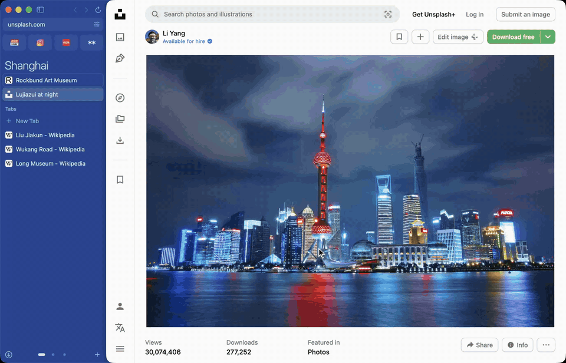

<p align="center">
  <a href="https://zigzagbrowser.com"></a>
</p>

<div align="center">

[English](README.md) | [简体中文](README.zh-Hans.md) | [繁體中文](README.zh-Hant.md) | [日本語](README.ja.md) | [한국어](README.ko.md) | [Deutsch](README.de.md) | [Français](README.fr.md) | Italiano | [Español](README.es.md) | [Português (Brasil)](README.pt-BR.md) | [Русский](README.ru.md) | [Nederlands](README.nl.md) | [Polski](README.pl.md) | [Türkçe](README.tr.md)

Questa pagina è la traduzione di README.md; in caso di differenze, fa fede la versione in inglese.

</div>

<p align="center">
  <a href="https://zigzagbrowser.com/download"><b>Scarica per Mac</b></a><br>
  <sub>oppure <code>brew install --cask zigaowang/tap/zigzag</code></sub><br>
  <sub>Gratuito e open source. Richiede macOS 15.4 o versioni successive.</sub>
</p>

<p align="center">
  I tuoi pannelli in una barra laterale, raggruppati in spazi. Un’app nativa per Mac scritta in Swift su WebKit,<br>
  circa 35 MB installata, senza account e senza telemetria.
</p>

## Perché l’ho creato

Ciao, sono Zigao, uno studente di liceo di Shanghai. Usavo Arc ogni giorno. Quando The Browser Company ha annunciato che avrebbe chiuso
Arc il 22 dicembre, non avevo nessuna voglia di tornare ai pannelli in alto, e le alternative che ho provato erano
fork di Chromium oppure browser costruiti attorno all’IA. Così ne ho fatto uno mio, e da allora è il mio browser principale.

**Perché WebKit e non Chromium?** In realtà avevo iniziato facendo un fork di Helium. Il sorgente pesava circa 100 GB e ogni compilazione
richiedeva da 3 a 4 ore sul mio Mac, un ritmo che da solo non posso sostenere. WebKit è già incluso in macOS, è
più leggero per batteria e memoria, e Apple distribuisce le sue correzioni di sicurezza con gli aggiornamenti di macOS. Le estensioni
di Chrome, comunque, restano disponibili, installate direttamente dal Chrome Web Store.

**Perché non Zen o Orion?** Li ho provati entrambi prima di iniziare e sono ottimi. Zen si basa su Firefox, quindi usa le estensioni
di Firefox e secondo me non sembra un’app per Mac. Orion è più vicino, ma non è open source. Volevo qualcosa
che funzionasse come Arc, fosse nativo, open source, e facesse girare le mie estensioni di Chrome.

## Se arrivi da Arc

**Il tuo Arc viene con te.** File › Importa da un altro browser…, scegli Arc, e arrivano i tuoi spazi, i pannelli fissati, le cartelle fissate, i preferiti,
la cronologia, le password, gli accessi e le estensioni. Possono arrivare anche i tuoi pannelli aperti, con le viste divise incluse, e restano in attesa di
caricarsi finché non fai clic su di essi; lascia deselezionato Pannelli aperti per ripartire da zero. Se i tuoi spazi si trovano su più di un profilo di Arc,
ogni profilo di Arc diventa un profilo Zigzag a sé.

**1Password funziona.** Installala dal Chrome Web Store dentro Zigzag, come faresti in Arc. Comunica con l’app
1Password. La prima volta, aggiungi Zigzag in 1Password › Impostazioni › Browser. Anche Bitwarden funziona.

**Non si può spegnere.** Non c’è nessun account e Zigzag non dipende da un mio server. Le uniche cose che
ospito sono il feed degli aggiornamenti e una breve lista di correzioni per il blocco pubblicità, e se sparissero, Zigzag continuerebbe a funzionare.
[Privacy](#privacy) elenca tutto ciò a cui Zigzag si connette da solo.

## Guardalo

<p align="center">
  
</p>

<table>
  <tr>
    <td width="50%"><br><b>Vista divisa.</b> Trascina un pannello sulla pagina per aprirlo di fianco, fino a quattro alla volta.</td>
    <td width="50%"><br><b>Tutti i pannelli insieme.</b> ⇧⌘\ mostra tutti gli spazi. Scrivi per filtrare.</td>
  </tr>
  <tr>
    <td width="50%"><br><b>Zigzag Mini.</b> Fai clic su un link tenendo premuto Maiuscole per dargli un’occhiata senza perdere il punto in cui sei.</td>
    <td width="50%"><br><b>Lettore.</b> Letture lunghe, senza distrazioni.</td>
  </tr>
</table>

<p align="center"><sub>Altro, in movimento, su <a href="https://zigzagbrowser.com">zigzagbrowser.com</a>.</sub></p>

## Cosa fa

| | |
|---|---|
| **Spazi** | Ognuno con il proprio colore, la propria icona, i propri pannelli fissati e le proprie cartelle. Scorri sulla barra laterale, o sposta la rotellina del mouse di lato, per cambiare. |
| **Preferiti** | I siti che usi di più come riquadri, sopra ogni spazio. Qualsiasi pannello, pannello fissato o preferito può avere una sua emoji o un suo simbolo. |
| **Profili** | Tieni separati lavoro e vita privata. Ogni profilo ha le proprie estensioni, i propri accessi, la propria cronologia e i propri preferiti, e ogni spazio appartiene a un profilo. |
| **Siti negli spazi** | Scegli uno spazio per un sito nei Controlli del sito o in Impostazioni › Spazi, e i suoi link si aprono lì da qualsiasi punto arrivino: un’altra app, ⌘T o un altro spazio, come con l’Air Traffic Control di Arc. Anche i percorsi possono andare in spazi propri, ad esempio `github.com/org1` in uno e `github.com/org2` in un altro. Uno spazio con un profilo suo funziona come un container di Firefox. |
| **Barra dei comandi** | ⌘T o ⌘L. Trova pannelli aperti, cronologia e siti. Scrivi `you`, premi Tab e stai cercando su YouTube. Trascina la barra dove vuoi nella finestra e da quel momento si apre lì. |
| **Gruppi di pannelli** | Seleziona alcuni pannelli e scegli Raggruppa pannelli, e diventano una cartella nella barra laterale che si apre e si chiude, si rinomina e si sposta come un tutt’uno. Trascina un pannello a destra per annidarlo sotto quello sopra, e a sinistra per tirarlo fuori. |
| **Cartelle live** | Una cartella fissata che si riempie da sola da un feed o da un sito, oppure da GitHub: pull request, richieste di revisione, o le issue e le pull request aperte nei tuoi repository. Le nuove pagine arrivano con un puntino. |
| **Vista divisa** | Fino a quattro pannelli: trascina un pannello sui bordi della pagina per una metà, o sugli angoli per un quarto. Trascina una pagina dalla sua striscia per spostarla, e fissa una vista divisa per tenerla. |
| **Finestre** | Trascina un pannello in un’altra finestra e si sposta così com’è, senza ricaricarsi. Attiva Impostazioni › Pannelli › Le finestre condividono i pannelli di uno spazio e ogni finestra su uno spazio elenca gli stessi pannelli, come in Arc. La barra laterale sta a sinistra o a destra. |
| **App web** | Installa come app trasforma un sito in un’app a sé, nella cartella Applicazioni, nel Dock e in ⌘Tab, con una barra degli strumenti del colore del sito. |
| **Mini player** | Lascia un pannello mentre il suo video è in riproduzione e il video ti segue in un piccolo player. Ridimensionalo da qualsiasi bordo e mettilo dove vuoi, anche fuori dalla finestra sopra altre app. Disattivalo dal suo menu se preferisci non averlo. Passa a un’altra app e il video resta sopra in Picture in Picture. |
| **Streaming** | Musica e video protetti si riproducono come in Safari, tramite FairPlay Streaming di WebKit: il web player di Spotify funziona, come altri servizi che supportano Safari. |
| **In riproduzione** | Ogni pannello che riproduce audio in background ottiene una scheda in fondo alla barra laterale, fino a tre, per metterlo in pausa o silenziarlo. |
| **Tutti i pannelli** | ⇧⌘\ mostra tutti gli spazi insieme. Scrivi per filtrare, trascina un pannello in un altro spazio. |
| **Svuota** | Chiude i pannelli che hai lasciato indietro e tiene quelli con cui stai lavorando. Passaci sopra per vedere quali chiuderebbe. Una vista divisa resta o se ne va per intero. Annulla li riporta indietro. |
| **Zigzag Mini** | ⌃⌘N apre una piccola finestra per una pagina al volo, e ⌘O la sposta nella finestra del browser. Fai clic su un link tenendo premuto Maiuscole, oppure scegli Apri link in Zigzag Mini, e si apre in una sopra la tua finestra; ⌘O la mette in un pannello accanto a quello in cui hai fatto clic, e Esc la chiude. I link di altre app si aprono al suo interno, come in Little Arc (disattivalo in Impostazioni › Zigzag Mini), e Apri in Zigzag Mini sposta un pannello in una di queste finestre. |
| **Password** | Nel Portachiavi del tuo Mac, sincronizzate con il Portachiavi di iCloud. Touch ID, un generatore e un controllo delle password deboli e riutilizzate. Le passkey funzionano. |
| **Pagine scure** | Siti chiari resi scuri dal motore di Dark Reader, con le sue correzioni per migliaia di siti, così le foto restano fedeli. I siti con un aspetto scuro tutto loro lo mantengono. Nero puro se lo preferisci più scuro. Attivo ovunque o per singolo sito. |
| **Blocco pubblicità** | Integrato e attivo: circa 130.000 regole di EasyList, EasyPrivacy e EasyList China, compilate in liste di regole per i contenuti di WebKit, più le liste di filtri di uBlock Origin, che si aggiornano da sole. |
| **WebRTC** | Attiva Proteggi l’indirizzo IP da WebRTC e i siti non possono scoprire il tuo vero indirizzo IP tramite WebRTC mentre usi un proxy o una VPN. Le chiamate funzionano sui siti che consenti, e un sito che prova a usare WebRTC mentre è bloccato lo segnala, con Consenti per questo sito. |
| **Banner dei cookie** | Rifiutati al posto tuo, mai accettati, con le regole di Autoconsent di DuckDuckGo. Lasciali stare ovunque o per un solo sito se preferisci rispondere tu. |
| **Controlli del sito** | Un pannello per ogni sito: zoom, permessi (fotocamera, microfono, posizione, notifiche, pop-up, apertura di app, condivisione dello schermo, WebRTC), ciascuno impostato su Chiedi, Consenti o Blocca, JavaScript attivo o disattivo, il certificato, le estensioni e gli interruttori per pagine scure, blocco pubblicità e banner dei cookie. Quando un sito ne richiede uno, lo chiede su un’unica scheda sopra la pagina, per questa volta o per sempre, e un sito a cui hai detto di no smette di chiedere. |
| **Boost** | Nascondi elemento nasconde le parti di un sito che non vuoi, come un banner o una barra laterale, e Modifica stile dà a un sito un CSS tutto tuo. Entrambi si trovano nel menu ⋯ dei Controlli del sito e restano legati al sito. |
| **Modalità sviluppatore** | Per i siti che crei, a cominciare da `localhost`: la console con il conteggio degli errori, Ispeziona elemento, dimensioni dei dispositivi, chiaro e scuro, stili di stampa, JavaScript, immagini o stili disattivati, un altro user agent e un codice QR per aprire la pagina sul telefono. |
| **Estensioni** | Dal Chrome Web Store, dove il pulsante dello store stesso dice Aggiungi a Zigzag. 1Password, Bitwarden, Dark Reader, Tampermonkey e la maggior parte di quelle più diffuse funzionano; più sotto trovi quelle che non funzionano. |
| **Importa** | Segnalibri, cronologia, password, accessi ed estensioni da Arc, Chrome, Safari, Dia, Edge, Brave, Vivaldi, Opera, Comet, Helium, Yandex, Whale, Chromium, Thorium, Firefox, Zen e Orion. |
| **Download** | Invia i file di un certo tipo in una cartella dedicata, oppure apri quelli sicuri come i PDF una volta salvati. Le regole trasferiscono un link o un download a un’app, a uno script o a un gestore di download come aria2, chiedendo prima a te. Vedi [docs/download-rules.md](docs/download-rules.md). |
| **Automazione** | AppleScript, Comandi rapidi e `osascript` possono elencare e aprire pannelli e leggere pagine, scritti nel modo in cui li accettano Safari e Chrome. Vedi [docs/automation.md](docs/automation.md). |
| **App IA** | Disattivato finché non lo attivi: le app IA sul tuo Mac possono usare i tuoi pannelli tramite MCP, mai le finestre private né le password. Vedi [docs/automation.md](docs/automation.md#ai-apps-mcp). |
| **I tuoi dati** | File › Esporta i tuoi dati… salva i tuoi segnalibri come file HTML standard che qualsiasi browser importa, e un backup completo di Zigzag che puoi ripristinare su un altro Mac. |
| **Lingue** | Inglese, cinese semplificato, cinese tradizionale, giapponese, coreano, tedesco, francese, italiano, spagnolo, portoghese brasiliano, russo, olandese, polacco e turco. |
| **E inoltre** | Lettore, visualizzatore PDF, Handoff verso iPhone, iPad o un altro Mac, Cattura di un’area, di una parte della pagina o dell’intera pagina (⇧⌘2), traduzione sul dispositivo, ricerca nella pagina che segna ogni corrispondenza, un menu Cronologia con Chiusi di recente e gli ultimi sette giorni, uno zoom predefinito delle pagine, una barra degli indirizzi sopra la pagina se la preferisci, Picture in Picture, finestre private, Web Inspector. |

## Cosa manca

È il mio browser di tutti i giorni, ma Zigzag è giovane e troverai dei bug. Cose che gli utenti di Arc noteranno:

- Nessuna sincronizzazione tra Mac o con iPhone. Le password si sincronizzano tramite il Portachiavi di iCloud; spazi e pannelli no.
- Le icone degli spazi non arrivano da Arc; scegliile di nuovo in Zigzag. I colori degli spazi arrivano come il colore Zigzag più vicino.
- Niente Easel né Note, e i Boost sono solo CSS (Nascondi elemento e Modifica stile, nessuno script per sito). Nessuna IA integrata nel browser: le app IA possono usare Zigzag tramite MCP solo se lo attivi.
- Mancano ancora alcune API delle estensioni di Chrome: l’API dei gruppi di pannelli, le impostazioni del debugger, l’accesso con l’account Google di Chrome (`identity.getAuthToken`) e il vecchio webRequest che blocca le richieste. Le estensioni proxy possono impostare un proxy HTTP, HTTPS o SOCKS5 fisso ma non uno script PAC, quindi la modalità Proxy by Patterns di FoxyProxy non funziona.
- EasyList e le altre liste di blocco integrate si aggiornano con Zigzag, non da sole; solo le liste di uBlock Origin lo fanno.
- Solo macOS 15.4 o versioni successive.

## Com’è fatto

Zigzag è composto da circa 120.000 righe di Swift 6 e AppKit attorno a `WKWebView`. Non c’è Chromium e non c’è Electron: il
motore è il WebKit incluso in macOS, per questo l’app è piccola e per questo le correzioni di sicurezza del motore arrivano
con gli aggiornamenti di macOS e non da me.

| Parte | Come |
|---|---|
| **Pagine** | Un `WKWebView` per pannello. I pannelli che non usi da un po’ possono essere sospesi: la web view viene rilasciata e il pannello conserva la sua istantanea e il suo stato, poi si ricarica quando ci torni. Le finestre private usano un archivio dati non persistente. |
| **Estensioni** | Il supporto di WebKit alle estensioni web (`WKWebExtensionController`, il motivo del minimo macOS 15.4). Zigzag scarica il pacchetto CRX3 dal Chrome Web Store, ne controlla le firme e lo carica. Le API di Chrome che WebKit non ha (cronologia, segnalibri, download, notifiche, riquadri laterali, pagine offscreen, accesso web, audio dei pannelli, pagine nuovo pannello, script utente, proxy e altro) sono gestite da Zigzag stesso tramite un piccolo bridge, controllate in base ai permessi di ciascuna estensione. Un motore di ricerca fornito da un’estensione (`search_provider`) si aggiunge alle scelte in Impostazioni, usato solo dopo che lo scegli. La messaggistica nativa collega le app di supporto di 1Password e di altre estensioni. |
| **Sandbox** | Le immagini e i PDF dei siti web vengono letti in due helper XPC in sandbox, `ZigzagImageDecoder` e `ZigzagPDFRenderer`, senza rete e senza accesso ai file, così un’immagine o un PDF malformato non può raggiungere le tue password o i tuoi profili. Il visualizzatore PDF disegna le pagine che l’helper elabora; l’app non apre mai da sola il PDF di un sito. |
| **Connessioni sicure** | Gli avvisi sui certificati dicono cosa non va sotto Dettagli. Un sito che ha richiesto solo connessioni sicure, tramite l’intestazione HSTS o l’elenco di precaricamento di Chromium (incluso, circa 95.000 nomi, letto sul posto solo quando un avviso lo richiede), non ottiene Visita comunque, come in Safari e Chrome. A un sito che chiede un certificato per identificarti vengono proposti quelli del tuo Portachiavi che accetterebbe, come in Safari: aggiungine uno aprendo il suo .p12 in Accesso Portachiavi. |
| **Blocco pubblicità** | EasyList, EasyPrivacy e EasyList China convertite in anticipo con SafariConverterLib in liste di regole per i contenuti (`WKContentRuleListStore`), compilate una volta e messe in cache. Le liste di uBlock Origin, scaricate alla loro scadenza, vengono confrontate dal motore adblocker di Ghostery nel suo contesto JavaScript, e ogni pagina riceve gli scriptlet e le regole di occultamento di cui il suo sito ha bisogno non appena inizia a caricarsi. |
| **Pagine scure** | Il tema dinamico di Dark Reader e le sue correzioni per i siti, incluse, in un mondo di script a parte. Alle pagine viene detto prima che la finestra è scura, così un sito con un proprio tema scuro lo usa e viene lasciato stare. |
| **Banner dei cookie** | Autoconsent di DuckDuckGo e le sue regole, incluse, in un mondo di script a parte. |
| **Password** | Salvate come elementi del Portachiavi, così il Portachiavi di iCloud le sincronizza e Touch ID le sblocca. Le passkey passano dall’entitlement di Apple per le passkey nel browser. Il riempimento automatico è un piccolo content script che compila solo i campi visibili. |
| **Importa** | Legge i file di ciascun browser: `StorableSidebar.json` di Arc, i segnalibri di Chromium e la cronologia SQLite, `Bookmarks.plist` di Safari, `places.sqlite` di Firefox, `favourites.plist` e `history` di Orion. Le password di Chromium vengono decifrate con la chiave dell’elemento del Portachiavi di quel browser, dopo che macOS te lo chiede. |
| **I tuoi dati** | Spazi, elementi fissati e preferiti in `Library.json`, profili in `Profiles.json`, pannelli aperti in `Session.json`, cronologia in SQLite (un file per profilo), tutto in `~/Library/Application Support/Zigzag`. Le scritture sono ritardate e atomiche, e un file che non si riesce a leggere viene messo da parte, mai sovrascritto. |
| **Lettore** | Readability di Mozilla, eseguito nella pagina, mostrato con la tipografia propria di Zigzag. |
| **App web** | Un sito installato come app è una piccola app a sé in `~/Applications/Zigzag Apps` che passa ogni avvio a Zigzag, così la pagina gira in Zigzag con i tuoi accessi, le tue estensioni e il tuo blocco. |
| **Aggiornamenti** | Sparkle 2, con aggiornamenti firmati EdDSA da zigzagbrowser.com, su un feed stabile o beta. Le versioni sono firmate con Developer ID e notarizzate. |

Il sorgente è organizzato per funzione: `Sidebar`, `Tabs`, `Web`, `Extensions`, `Passwords`, `Import`, `Profiles`,
`CommandBar`, `Desk` (tutti i pannelli insieme), `WebApps`, `Developer`, `MCP` (app IA), `Settings`, `Window` e
`Design` (i controlli disegnati da Zigzag e i token di design). Oltre 2.000 test coprono importazione, password, estensioni,
gestione degli indirizzi, cronologia, app IA e le correzioni di sicurezza.

## Privacy

Nessun account, nessuna analisi, nessuna telemetria. Nulla di come navighi viene inviato a me. Queste sono le uniche
connessioni che Zigzag stabilisce da solo, oltre alle pagine che apri:

- **Aggiornamenti.** Ogni poche ore, e dopo la riattivazione del Mac, Zigzag legge il feed degli aggiornamenti su
  zigzagbrowser.com. La richiesta indica la versione di Zigzag e nient’altro; non viene inviato alcun profilo del sistema. Anche la nuova versione si scarica da lì.
- **Suggerimenti di ricerca.** Mentre scrivi nella barra degli indirizzi, il testo va al tuo motore di ricerca per ottenere suggerimenti,
  senza cookie. Google, DuckDuckGo, Brave, Bing, Kagi ed Ecosia li offrono; con qualsiasi altro motore non viene
  inviato nulla. Disattivali in Impostazioni › Cerca.
- **Icone dei siti.** Le icone arrivano da ogni sito stesso, anche per i pannelli fissati, i preferiti e i segnalibri importati che
  non hai ancora aperto.
- **Liste di filtri.** All’avvio e poi alla loro scadenza, da ogni poche ore a una volta al giorno, Zigzag scarica le
  liste di filtri di uBlock Origin dagli indirizzi di uBlock Origin stesso (GitHub Pages, Cloudflare Pages o jsDelivr) e i suoi
  scriptlet dalla CDN di Ghostery. Scarica anche la breve lista di correzioni per i siti di Zigzag da zigzagbrowser.com.
  Le richieste non portano cookie, né nulla su di te o sulla tua navigazione.
- **Estensioni.** Installarne una la scarica dal Chrome Web Store. All’avvio, al massimo una volta al giorno, Zigzag
  chiede allo store se le tue estensioni hanno aggiornamenti, e questo invia a Google i loro ID e le loro versioni.
- **Configurazione.** Le schermate di benvenuto mostrano alcune icone di siti dal servizio di icone di Google e caricano la pagina iniziale di Wikipedia
  come anteprima.

La traduzione avviene sul tuo Mac, con la Traduzione sul dispositivo di Apple. Gli avvisi sui siti web fraudolenti sono quelli di WebKit,
gli stessi di Safari. Le password restano nel Portachiavi del tuo Mac e si sincronizzano solo tramite il tuo Portachiavi di iCloud.
Aiuto › Segnala un problema scrive un rapporto che puoi leggere prima, e non viene inviato nulla se non lo invii tu.
L’elenco Password del Mac tiene un piccolo registro dei suoi passaggi in `~/Library/Logs/Zigzag/passwords.log`, mai un accesso né
un sito, e resta sul tuo Mac. La tua carta Zigzag viene creata sul tuo Mac dal nome del tuo account e dal giorno in cui Zigzag
è stato avviato per la prima volta, e la sua immagine contiene solo ciò che la carta mostra.

## Installazione

Scarica il DMG da [zigzagbrowser.com](https://zigzagbrowser.com/download), aprilo e trascina Zigzag in
Applicazioni. Oppure, con Homebrew:

    brew install --cask zigaowang/tap/zigzag

Gli aggiornamenti si installano da soli. Cosa è cambiato in ogni versione si trova nelle
[note di rilascio](https://zigzagbrowser.com/release-notes) e in [CHANGELOG.md](CHANGELOG.md).

## Feedback

- **Bug e idee:** [apri una issue](https://github.com/ZigaoWang/zigzag/issues/new/choose), oppure Aiuto › Invia feedback… nell’app. Per un bug, Aiuto › Segnala un problema… scrive un rapporto che puoi leggere prima di inviarlo.
- **Email:** a@zigao.wang
- **Problemi di sicurezza:** vedi [SECURITY.md](SECURITY.md). Per favore, non pubblicarli nelle issue pubbliche.

## Compilare dal sorgente

Requisiti: macOS 15.4 o versioni successive, Xcode 27 o successivo e [XcodeGen](https://github.com/yonaskolb/XcodeGen).

```sh
brew install xcodegen
git clone https://github.com/ZigaoWang/zigzag.git
cd zigzag
xcodegen generate
open Zigzag.xcodeproj
```

Esegui lo schema **Zigzag**. Le build Debug girano come un’app separata, “Zigzag Dev”, con i propri dati, così non
toccano mai il tuo Zigzag di tutti i giorni.

La firma è configurata per il mio team. Per compilare sul tuo Mac, cambia due cose in `project.yml` ed esegui di nuovo
`xcodegen generate`:

- `DEVELOPMENT_TEAM`: l’ID del tuo team (lo mostra Xcode › Settings › Accounts).
- Il `PRODUCT_BUNDLE_IDENTIFIER` di Debug: uno tuo, come `com.yourname.zigzag.dev`, dato che
  `wang.zigao.zigzag.dev` è registrato sul mio team.

Esegui i test:

```sh
xcodebuild test -project Zigzag.xcodeproj -scheme Zigzag
```

## Contribuire

I contributi sono benvenuti. Leggi [CONTRIBUTING.md](CONTRIBUTING.md) per sapere come il progetto viene compilato, testato e
formattato.

## Licenza

Il codice di Zigzag è distribuito con la [licenza Apache, versione 2.0](LICENSE). Usalo, modificalo, fanne un fork e distribuiscilo,
a scopo commerciale o no.

Il nome “Zigzag”, l’icona dell’app e il logo non sono coperti dalla licenza: sono marchi, con tutti i diritti
riservati. Un fork ha bisogno di un nome e di un’icona propri. Vedi [TRADEMARKS.md](TRADEMARKS.md) e [NOTICE](NOTICE).
Le opere di terze parti usate da Zigzag sono elencate in [THIRD_PARTY_NOTICES.md](THIRD_PARTY_NOTICES.md).

## Ringraziamenti

Grazie alla community di [LINUX DO](https://linux.do) per aver provato Zigzag fin dall’inizio e per i loro feedback.

<p align="center">
  <a href="https://linux.do"></a>
</p>
