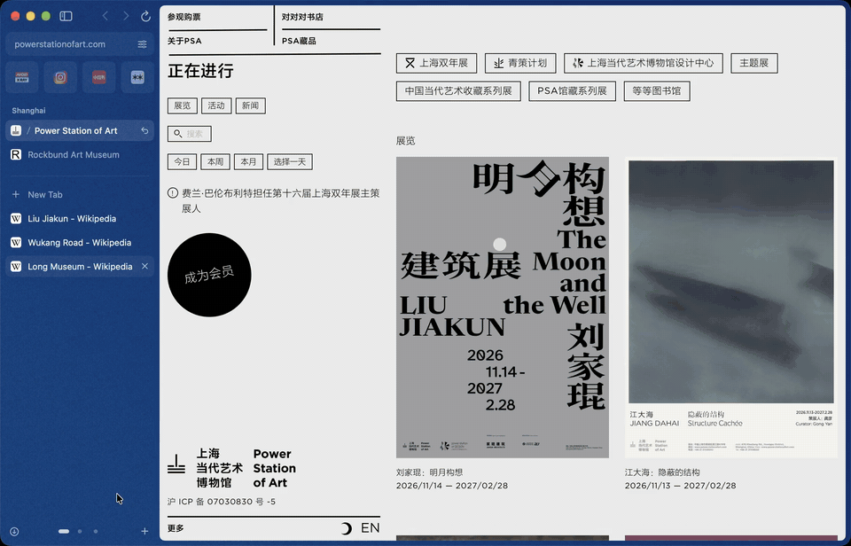

<p align="center">
  
</p>

<p align="center">
  
  
</p>

<p align="center">
  <b>Feels great. Weighs nothing.</b><br>
  The lightweight browser for Mac.
</p>

<p align="center">
  <a href="https://zigzagbrowser.com/download"><b>Download for Mac</b></a><br>
  <sub>or <code>brew install --cask zigaowang/tap/zigzag</code></sub><br>
  <sub>Free. macOS 15.4 or later. Version 0.3.1, in beta.</sub>
</p>

<p align="center">
  
</p>

## Coming from Arc

**Your Arc comes with you.** File › Import, pick Arc, and your spaces, pinned tabs, pinned folders, Favorites,
history and passwords come over. The pile of open tabs stays behind, so you start clean.

**1Password works.** Install it from the Chrome Web Store inside Zigzag, like you would in Arc. It talks to the
1Password app. The first time, add Zigzag in 1Password › Settings › Browser.

**No account.** There's nothing to sign up for or sign in to. Download it and go.

**It can't be switched off.** Zigzag doesn't depend on a server of mine. The only thing I host is the update
feed, and if that went away, Zigzag would keep working. The engine's security updates come from Apple, with
macOS. Search suggestions are on by default and come from your search engine; you can turn them off in Settings.

## What it does

| | |
|---|---|
| **Spaces** | Each with its own color, pinned tabs and folders. Swipe on the sidebar, or nudge the mouse wheel sideways, to switch. |
| **Favorites** | Your most used sites as tiles, above every space. |
| **Command bar** | ⌘T or ⌘L. Finds open tabs, history and sites. Type `you`, press Tab, and you're searching YouTube. |
| **Split view** | Drag a tab onto the page. Pin a split and it stays one. |
| **Peek** | Shift-click a link to read it over the page you're on. |
| **All tabs** | ⇧⌘\ shows every space at once. Type to filter, drag a tab to another space. |
| **Clear** | Closes tabs you haven't looked at in a while first, and keeps today's. |
| **Passwords** | In your Mac's Keychain, synced by iCloud Keychain. Touch ID, a generator, and a check for weak and reused ones. Passkeys work. |
| **Ad blocking** | Built in and on, with EasyList and EasyPrivacy. |
| **Extensions** | From the Chrome Web Store. Most popular ones work; see below for what doesn't. |
| **Import** | Arc, Chrome, Safari, Dia, Edge, Brave, Vivaldi, Opera, Firefox and Zen. |
| **And** | Reader, PDF viewer, full-page screenshots (⇧⌘2), translation, picture in picture, private windows, Web Inspector. |

## What's missing

Zigzag is a beta. It's my everyday browser, but you'll find bugs. Things Arc users will notice:

- No sync between Macs or to iPhone. Passwords sync through iCloud Keychain; spaces and tabs don't.
- No separate profiles. Every space shares the same logins.
- Space icons and emoji don't exist yet, so they don't come over from Arc. Space colors come over as the nearest Zigzag color.
- No Little Arc. Links from other apps open as a tab in your window.
- No Boosts, Easels, Notes, or AI features.
- Some Chrome extension APIs aren't there yet: tab groups, side panel, downloads, bookmarks and history, and Google sign-in inside an extension. Bitwarden installs, but its popup doesn't show.
- Chrome bookmarks come over without their folders.
- The ad blocking lists update with Zigzag, not on their own.
- macOS 15.4 or later only.

## Install

Download the DMG from [zigzagbrowser.com](https://zigzagbrowser.com/download), open it, and drag Zigzag to
Applications. Or, with Homebrew:

    brew install --cask zigaowang/tap/zigzag

Updates install by themselves. What changed in each version is in the
[release notes](https://zigzagbrowser.com/release-notes) and [CHANGELOG.md](CHANGELOG.md).

## Feedback

- **Bugs and ideas:** [open an issue](https://github.com/ZigaoWang/zigzag/issues/new/choose), or Help › Send Feedback… in the app.
- **Email:** a@zigao.wang
- **Security problems:** see [SECURITY.md](SECURITY.md). Please don't post them in public issues.

## Build from source

Requirements: macOS 15.4 or later, Xcode 26 or later, and [XcodeGen](https://github.com/yonaskolb/XcodeGen).

```sh
brew install xcodegen
git clone https://github.com/ZigaoWang/zigzag.git
cd zigzag
xcodegen generate
open Zigzag.xcodeproj
```

Run the **Zigzag** scheme. Debug builds run as a separate app, "Zigzag Dev", with their own data, so they never
touch your everyday Zigzag. To sign with your own Apple ID, set `DEVELOPMENT_TEAM` in `project.yml` and run
`xcodegen generate` again.

Run the tests:

```sh
xcodebuild test -scheme Zigzag
```

## Contributing

Contributions are welcome. Read [CONTRIBUTING.md](CONTRIBUTING.md) for how the project is built, tested and
styled.

## License

Zigzag's code is licensed under the [Apache License, Version 2.0](LICENSE). Use it, change it, fork it and ship
it, commercially or not.

The name "Zigzag", the app icon and the logo are not covered by the license: they're trademarks, all rights
reserved. A fork needs its own name and icon. See [TRADEMARKS.md](TRADEMARKS.md) and [NOTICE](NOTICE).
Third-party work Zigzag uses is listed in [THIRD_PARTY_NOTICES.md](THIRD_PARTY_NOTICES.md).
