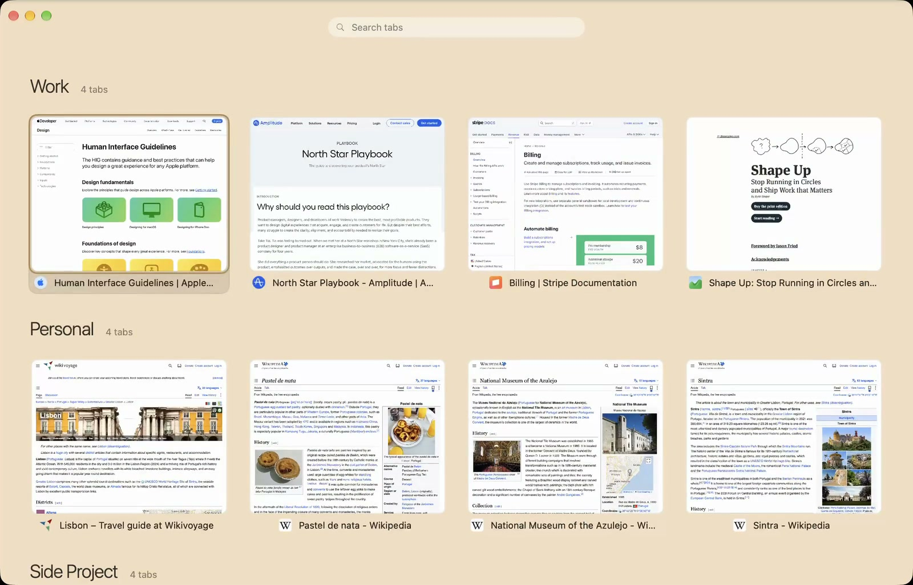

# Zigzag
> Feels great. Weighs Nothing. The new Arc browser.

[](https://opensource.org/license/apache/)


 
<p align="center">
  <a href="https://zigzagbrowser.com"></a>
</p>

<p align="center">
  <a href="https://zigzagbrowser.com/download"><b>Download for Mac</b></a><br>
  <sub>or <code>brew install --cask zigaowang/tap/zigzag</code></sub><br>
  <sub>Free and open source. macOS 15.4 or later.</sub>
</p>

<p align="center">
  Your tabs in a sidebar, grouped into spaces. Native Mac app in Swift on WebKit.<br>
  35 MB installed. No account, no telemetry.
</p>

## 🤔 1. Features

| | |
|---|---|
| **Spaces** | Each with its own color, icon, pinned tabs and folders. Switch between them easily with trackpad or mouse. |
| **Favorites** | Your most used sites as tiles above every space. Any tab can wear its own symbol. |
| **Profiles** | Keep work and personal apart. Each profile has its own extensions, sign-ins, history and favorites. |
| **Sites in spaces** | Choose a space for a site, in Site Controls or Settings, and its links open wherever they come from: another app, ⌘T or another space, as with Arc's Air Traffic Control. *A space on its own profile works like a Firefox container.* |
| **Command bar** | ⌘T or ⌘L. Finds open tabs, history and sites. *Type `you`, press Tab, and you're searching YouTube.* |
| **Import** | Import everything you had from most other browsers, including Arc, Chrome, Safari, Edge... *(see below for full list)* |
| **Extensions** | From the Chrome Web Store. Most popular extensions work for Zigzag. |
| **Tab groups** | Pick some tabs and choose Group Tabs, and they become a folder in the sidebar that moves as one. |
| **Split view** | Up to four tabs in one page. Drag a page by its strip to move it, and pin a split to keep it. |
| **Windows** | Rearrange tabs easily without it reloading. *Customization settings for sidebar and tabs included.* |
| **Web apps** | Make a site an app on its own for easy access. *Just like Safari.* |
| **Ad blocking** | Built in and on: about 130,000 EasyList, EasyPrivacy and EasyList China rules, plus auto-updating uBlock Origin filter lists. |
| **Peek** | Shift-click a link to read it over the page you're on. |
| **Mini player** | Leave a tab while its video plays, and the video follows you in a small player. Resize it, move it, switch it freely. |
| **Now Playing** | Every tab playing sound in the background gets a card at the foot of the sidebar, up to three. Pause or mute it instantly. |
| **All tabs** | ⇧⌘\ shows every space at once. Type to filter, drag a tab to another space. |
| **Clear** | Closes the tabs you've drifted away from and keeps the ones you're working with. Undo brings them back. |
| **Zigzag Mini** | ⌃⌘N opens a small window for one quick page, and ⌘O moves it into your browser window. Links from other apps can open in it, like Little Arc, and Open in Zigzag Mini moves a tab into one. |
| **Passwords** | In your Mac's Keychain, synced by iCloud Keychain. Touch ID, a generator, and a check for weak and reused ones. Passkeys work. |
| **Dark pages** | Light any site drawn dark by DarkReader's engine. Photos stay true. Sites with a dark look of their own keep it. Pure black if you like it darker. |
| **Cookie pop-ups** | Turned down for you, never accepted, with DuckDuckGo's Autoconsent rules. Leave them alone everywhere or for one site if you'd rather answer yourself. |
| **Site Controls** | One panel per site: zoom, permissions (Ask/Allow/Block, JavaScript on/off), certificate, extensions, switches for dark pages, ad blocking and cookie pop-ups. |
| **Developer Mode** | For sites you build, get access to the console, inspect elements, device sizes, JavaScript, and more features for devs.|
| **AI apps** | Off until you turn it on: AI apps on your Mac can use your tabs over MCP, never private windows or passwords. See [docs/automation.md](docs/automation.md#ai-apps-mcp). |
| **Downloads** | Send files of a type to a folder of their own. Rules hand a download link to a download manager script, asking you first. See [docs/download-rules.md](docs/download-rules.md). |
| **Automation** | AppleScript, Shortcuts and osascript can list and open tabs and read pages, written the way Safari and Chrome take them. See [docs/automation.md](docs/automation.md). |
| **WebRTC** | Turn on Protect IP address from WebRTC, and sites can't learn your real IP address through WebRTC while you use a proxy or VPN. Calls work on the sites you allow, and a site that tries WebRTC while it's blocked says so, with Allow for This Site. |
| **Languages** | English and Simplified Chinese. |
| **And** | Reader, PDF viewer, full-page screenshots (⇧⌘2), on-device translation, find on page, History menu with Recently Closed, default page zoom, address bar above the page (optional), Picture in Picture, private windows, Web Inspector. |

**Supported browsers for data import.** Bookmarks, history, passwords, and more from: 

- Arc
- Brave
- Chrome
- Chromium
- Comet
- Dia
- Edge
- Firefox
- Helium
- Opera
- Orion
- Safari
- Thorium
- Vivaldi
- Whale
- Yandex
- Zen

**Popular extensions supported:** 1Password, Bitwarden, Dark Reader, Tampermonkey, and more!

## 🛬 2. Coming from Arc

**Your Arc comes with you.** File › Import from Another Browser…, pick Arc, and your spaces, pinned tabs, pinned folders, Favorites,
history, passwords, sign-ins and extensions come over. Your open tabs can come too, split views and all, and wait to
load until you click them; leave Open Tabs unchecked to start clean. If your spaces are on more than one Arc profile,
each Arc profile comes over as a Zigzag profile of its own.

**1Password works.** Install it from the Chrome Web Store inside Zigzag, like you would in Arc. It talks to the
1Password app. The first time, add Zigzag in 1Password › Settings › Browser. Bitwarden works too.

**Zigzag stays. Arc is gone.** There's no account, and Zigzag doesn't depend on a server of mine. The only things I
host are the update feed and a short list of ad blocking fixes, and if they went away, Zigzag would keep working.
[Privacy](#privacy) lists everything Zigzag connects to on its own.

## 👀 3. See it

<p align="center">
  
</p>

<table>
  <tr>
    <td width="50%"><br><b>Split View.</b> Drag a tab onto the page to open it beside, up to four at once.</td>
    <td width="50%"><br><b>Every tab at once.</b> ⇧⌘\ shows every space. Type to filter.</td>
  </tr>
  <tr>
    <td width="50%"><br><b>Peek.</b> Shift-click a link to glance at it without losing your place.</td>
    <td width="50%"><br><b>Reader.</b> Long reads, without the clutter.</td>
  </tr>
</table>

<p align="center"><sub>More, in motion, at <a href="https://zigzagbrowser.com">zigzagbrowser.com</a>.</sub></p>


## 4. Why I built it

I used Arc every day. When The Browser Company said it's shutting
Arc down on December 22, I really didn't want to go back to tabs along the top, and the alternatives I tried were
either Chromium forks or browsers built around AI. So I made my own, and I've used it as my main browser ever since.

**Why WebKit and not Chromium?** I actually started by forking Helium. The source was about 100 GB and every build
took 3 to 4 hours on my Mac, which isn't something I can keep up by myself. WebKit already comes with macOS, it's
lighter on battery and memory, and Apple ships its security fixes with macOS updates. You still get Chrome
extensions, installed straight from the Chrome Web Store.

**Why not Zen or Orion?** I tried both before starting this, and they're good. Zen runs on Firefox, so it uses Firefox
extensions and doesn't feel like a Mac app to me. Orion is closer, but it isn't open source. I wanted something
that works like Arc, feels native, is open source, and runs my Chrome extensions.


## 5. Limitations

It's my everyday browser, but Zigzag is young and you'll find bugs. Things Arc users will notice:

- No sync between Macs or to iPhone. Passwords sync through iCloud Keychain; spaces and tabs don't.
- Space icons don't come over from Arc; pick them again in Zigzag. Space colors come over as the nearest Zigzag color.
- No Boosts, Easels or Notes, and no AI built into the browser: AI apps can use Zigzag over MCP only if you turn it on.
- A few Chrome extension APIs aren't there yet: the tab groups API, debugger settings, Chrome's own Google account sign-in (`identity.getAuthToken`), and the old request-blocking webRequest. Proxy extensions can set a fixed HTTP, HTTPS or SOCKS5 proxy but not a PAC script, so FoxyProxy's Proxy by Patterns mode doesn't work.
- EasyList and the other built-in blocking lists update with Zigzag, not on their own; only uBlock Origin's lists do.
- macOS 15.4 or later only.

## 🔨 6. How it's built

Zigzag is about 120,000 lines of Swift 6 and AppKit around `WKWebView`. There's no Chromium and no Electron: the
engine is the WebKit that ships with macOS, which is why the app is small and why engine security fixes arrive
with macOS updates rather than from me.

| Part | How |
|---|---|
| **Pages** | One `WKWebView` per tab. Tabs you haven't used in a while can be suspended: the web view is released and the tab keeps its snapshot and state, then reloads when you come back. Private windows use a non-persistent data store. |
| **Extensions** | WebKit's web extension support (`WKWebExtensionController`, the reason for the macOS 15.4 minimum). Zigzag downloads the CRX3 package from the Chrome Web Store, checks its signatures, and loads it. Chrome APIs WebKit doesn't have (history, bookmarks, downloads, notifications, side panels, offscreen pages, web sign-in, tab audio, new tab pages, user scripts, proxies and more) are answered by Zigzag itself through a small bridge, checked against each extension's own permissions. A search engine an extension gives (`search_provider`) joins the choices in Settings, used only once you pick it. Native messaging connects the helper apps of 1Password and other extensions. |
| **Sandboxing** | Pictures and PDFs from websites are read in two sandboxed XPC helpers, `ZigzagImageDecoder` and `ZigzagPDFRenderer`, with no network and no file access, so a malformed image or PDF can't reach your passwords or profiles. The PDF viewer draws the pages the helper renders; the app never opens a site's PDF itself. |
| **Secure connections** | Certificate warnings say what's wrong under Details. A site that asked for secure connections only, by its HSTS header or on Chromium's preload list (bundled, about 95,000 names, read in place only when a warning needs it), gets no Visit anyway, as in Safari and Chrome. A site that asks for a certificate to identify you is offered the ones in your Keychain that it would take, as in Safari: add one by opening its .p12 in Keychain Access. |
| **Ad blocking** | EasyList, EasyPrivacy and EasyList China converted ahead of time with SafariConverterLib into content rule lists (`WKContentRuleListStore`), compiled once and cached. uBlock Origin's lists, downloaded as they expire, are matched by Ghostery's adblocker engine in its own JavaScript context, and each page gets the scriptlets and hiding rules its site needs as it starts to load. |
| **Dark pages** | Dark Reader's dynamic theme and its site fixes, bundled, in a script world of its own. Pages are told the window is dark first, so a site with its own dark theme uses it and is left alone. |
| **Cookie pop-ups** | DuckDuckGo's Autoconsent and its rules, bundled, in a script world of its own. |
| **Passwords** | Saved as Keychain items, so iCloud Keychain syncs them and Touch ID unlocks them. Passkeys go through Apple's browser passkey entitlement. Autofill is a small content script that only fills fields you can see. |
| **Import** | Reads each browser's own files: Arc's `StorableSidebar.json`, Chromium's bookmarks and SQLite history, Safari's `Bookmarks.plist`, Firefox's `places.sqlite`, Orion's `favourites.plist` and `history`. Chromium passwords are decrypted with the key from that browser's Keychain item, after macOS asks you. |
| **Your data** | Spaces, pins and favorites in `Library.json`, profiles in `Profiles.json`, open tabs in `Session.json`, history in SQLite (one file per profile), all under `~/Library/Application Support/Zigzag`. Writes are debounced and atomic, and a file that can't be read is set aside, never overwritten. |
| **Reader** | Mozilla's Readability, run in the page, shown in Zigzag's own typography. |
| **Web apps** | A site installed as an app is a small app of its own in `~/Applications/Zigzag Apps` that hands every launch to Zigzag, so the page runs in Zigzag with your sign-ins, extensions and blocking. |
| **Updates** | Sparkle 2, with EdDSA-signed updates from zigzagbrowser.com, on a stable or a beta feed. Releases are signed with Developer ID and notarized. |

The source is organized by feature: `Sidebar`, `Tabs`, `Web`, `Extensions`, `Passwords`, `Import`, `Profiles`,
`CommandBar`, `Desk` (every tab at once), `Peek`, `WebApps`, `Developer`, `MCP` (AI apps), `Settings`, `Window` and
`Design` (Zigzag's own drawn controls and design tokens). Over 2,000 tests cover importing, passwords, extensions,
address handling, history, AI apps and the security fixes.

## 7. Privacy

No account, no analytics, no telemetry. Nothing about how you browse is sent to me. These are the only
connections Zigzag makes on its own, apart from the pages you open:

- **Updates.** Every few hours, and after your Mac wakes, Zigzag reads the update feed at zigzagbrowser.com. The
  request says Zigzag's version and nothing else; no system profile is sent. A new version downloads from there too.
- **Search suggestions.** As you type in the address bar, the text goes to your search engine for suggestions,
  without cookies. Google, DuckDuckGo, Brave, Bing, Kagi and Ecosia offer them; with any other engine, nothing is
  sent. Turn them off in Settings › Search.
- **Site icons.** Icons come from each site itself, also for pinned tabs, favorites and imported bookmarks you
  haven't opened yet.
- **Filter lists.** At launch and then as they expire, every few hours to once a day, Zigzag downloads uBlock
  Origin's filter lists from uBlock Origin's own addresses (GitHub Pages, Cloudflare Pages or jsDelivr) and its
  scriptlets from Ghostery's CDN. It also downloads Zigzag's own short list of site fixes from zigzagbrowser.com.
  The requests carry no cookies, and nothing about you or your browsing.
- **Extensions.** Installing one downloads it from the Chrome Web Store. At launch, at most once a day, Zigzag
  asks the store whether your extensions have updates, which sends their IDs and versions to Google.
- **Setup.** The welcome screens show a few site icons from Google's icon service and load Wikipedia's front page
  as a preview.

Translation runs on your Mac, with Apple's on-device Translation. Fraudulent website warnings are WebKit's own,
the same as Safari's. Passwords stay in your Mac's Keychain and sync only through your own iCloud Keychain.
Help › Report a Problem writes a report you can read first, and nothing is sent unless you send it.

## 🛠️ 8. Install

Download the DMG from [zigzagbrowser.com](https://zigzagbrowser.com/download), open it, and drag Zigzag to
Applications. Or, with Homebrew:

    brew install --cask zigaowang/tap/zigzag

Updates install by themselves. What changed in each version is in the
[release notes](https://zigzagbrowser.com/release-notes) and [CHANGELOG.md](CHANGELOG.md).

## 💬 9. Feedback

- **Bugs and ideas:** [open an issue](https://github.com/ZigaoWang/zigzag/issues/new/choose), or Help › Send Feedback… in the app. For a bug, Help › Report a Problem… writes a report you can read before you send it.
- **Email:** a@zigao.wang
- **Security problems:** see [SECURITY.md](SECURITY.md). Please don't post them in public issues.

## 10. Build from source

Requirements: macOS 15.4 or later, Xcode 26 or later, and [XcodeGen](https://github.com/yonaskolb/XcodeGen).

```sh
brew install xcodegen
git clone https://github.com/ZigaoWang/zigzag.git
cd zigzag
xcodegen generate
open Zigzag.xcodeproj
```

Run the **Zigzag** scheme. Debug builds run as a separate app, "Zigzag Dev", with their own data, so they never
touch your everyday Zigzag.

Signing is set up for my team. To build on your Mac, change two things in `project.yml` and run
`xcodegen generate` again:

- `DEVELOPMENT_TEAM`: your own team ID (Xcode › Settings › Accounts shows it).
- The Debug `PRODUCT_BUNDLE_IDENTIFIER`: one of your own, such as `com.yourname.zigzag.dev`, since
  `wang.zigao.zigzag.dev` is registered to my team.

Run the tests:

```sh
xcodebuild test -project Zigzag.xcodeproj -scheme Zigzag
```

## 11. Contributing

Contributions are welcome. Read [CONTRIBUTING.md](CONTRIBUTING.md) for how the project is built, tested and
styled.

## 12. License

Zigzag's code is licensed under the [Apache License, Version 2.0](LICENSE). Use it, change it, fork it and ship
it, commercially or not.

The name "Zigzag", the app icon and the logo are not covered by the license: they're trademarks, all rights
reserved. A fork needs its own name and icon. See [TRADEMARKS.md](TRADEMARKS.md) and [NOTICE](NOTICE).
Third-party work Zigzag uses is listed in [THIRD_PARTY_NOTICES.md](THIRD_PARTY_NOTICES.md).

## ❤️ 13. Acknowledgments

Thanks to the [LINUX DO](https://linux.do) community for trying Zigzag early and sharing their feedback.

And most of all, thanks to you for using Zigzag. Welcome to the new Arc.

<p align="center">
  <a href="https://linux.do"></a>
</p>
