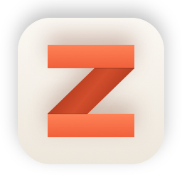
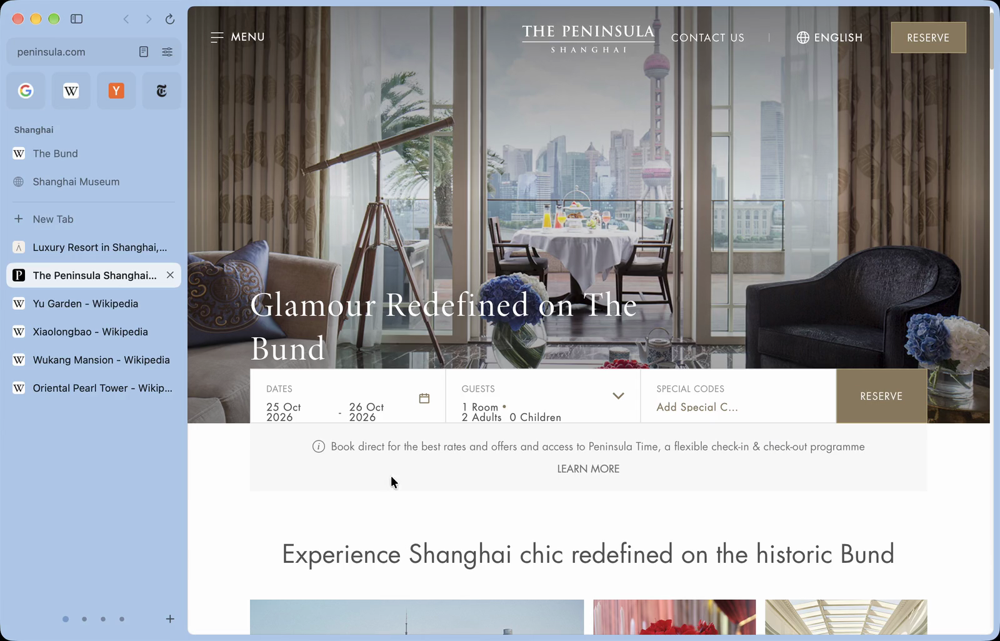

<p align="center">
  
</p>

<p align="center">
  
  
</p>

<p align="center">
  <b>Feels great. Weighs nothing.</b><br>
  The lightweight browser for Mac.
</p>

<p align="center">
  <a href="https://zigzagbrowser.com/download"><b>Download for Mac</b></a>
</p>

<br>



## About

Zigzag is a browser for the Mac with a sidebar, spaces, and a page that floats. It's written from scratch in
Swift and AppKit on WebKit, Safari's engine, so it stays light on memory and battery, and engine security
updates arrive with macOS. There's no account and no server: your data stays on your Mac.

## Features

| | |
|---|---|
| **Spaces** | Separate sets of tabs, each with its own color. |
| **Command bar** | Find open tabs, history and sites. Type `you`, press Tab, and search YouTube. |
| **Peek** | Shift-click a link to read it over the page you're on. |
| **Split View** | Drag a tab onto the page to open it beside. |
| **Reader** | The article alone, in clean, readable type. |
| **Ad blocking** | Built in, with EasyList and EasyPrivacy. |
| **Passwords** | Stored in your Mac's Keychain; import from any browser. |
| **Import** | One click from Arc, Chrome, Safari, Dia, Edge, Brave or Firefox. |
| **Extensions** | Most popular Chrome extensions, from the Chrome Web Store. |

## Install

Download the DMG from [zigzagbrowser.com](https://zigzagbrowser.com/download), open it, and drag Zigzag to
Applications. Updates install automatically. What changed in each version is in the
[release notes](https://zigzagbrowser.com/release-notes) ([CHANGELOG.md](CHANGELOG.md) in this repository).

## Feedback

Zigzag is in **beta**: ready for everyday use, with rough edges still being polished.

- **Bugs and ideas:** [open an issue](https://github.com/ZigaoWang/zigzag/issues/new/choose), or choose
  **Help › Send Feedback…** in the app.
- **Email:** a@zigao.wang
- **Security problems:** see [SECURITY.md](SECURITY.md). Please don't report them in public issues.

## Build from source

Requirements: macOS 15.4 or later, Xcode 26 or later, and [XcodeGen](https://github.com/yonaskolb/XcodeGen).

```sh
brew install xcodegen
git clone https://github.com/ZigaoWang/zigzag.git
cd zigzag
xcodegen generate
open Zigzag.xcodeproj
```

Run the **Zigzag** scheme. Debug builds run as a separate app, "Zigzag Dev", with their own data, so they never
touch your everyday Zigzag. To sign with your own Apple ID, set `DEVELOPMENT_TEAM` in `project.yml` and run
`xcodegen generate` again.

Run the tests:

```sh
xcodebuild test -scheme Zigzag
```

## Contributing

Contributions are welcome. Read [CONTRIBUTING.md](CONTRIBUTING.md) for how the project is built, tested and
styled.

## License

Zigzag is source available under the [Functional Source License, Version 1.1, MIT Future License
(FSL-1.1-MIT)](LICENSE). Each version becomes MIT licensed two years after its release. Forks and contributions
are welcome.

| Allowed | Not allowed, until a version turns two |
|---|---|
| Reading, building and running the code | Offering it, or a product built from it, as a competing commercial product |
| Forking and changing it | |
| Contributing back | |

After two years, each version is available under the [MIT license](https://opensource.org/license/mit). See
[LICENSE](LICENSE) for the full terms and [THIRD_PARTY_NOTICES.md](THIRD_PARTY_NOTICES.md) for the work of
others included in Zigzag.

<sub>Zigzag isn't affiliated with The Browser Company. © 2026 Zigao Wang.</sub>
