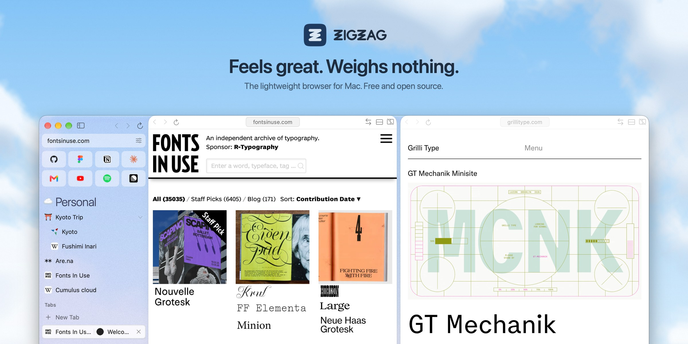
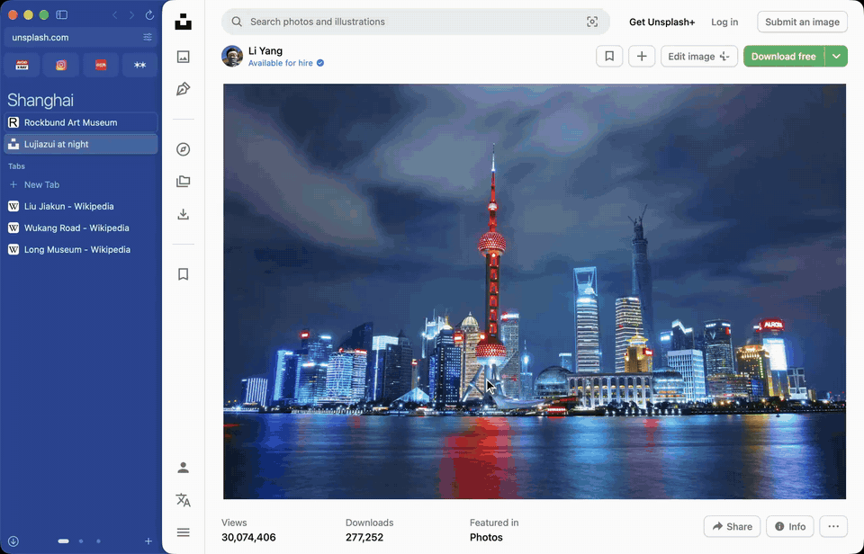
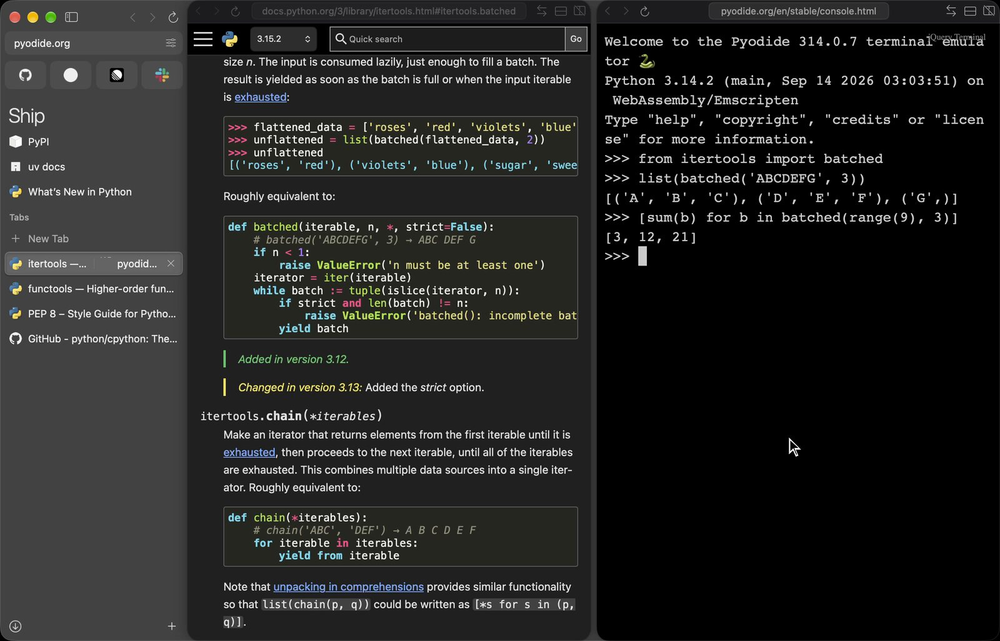
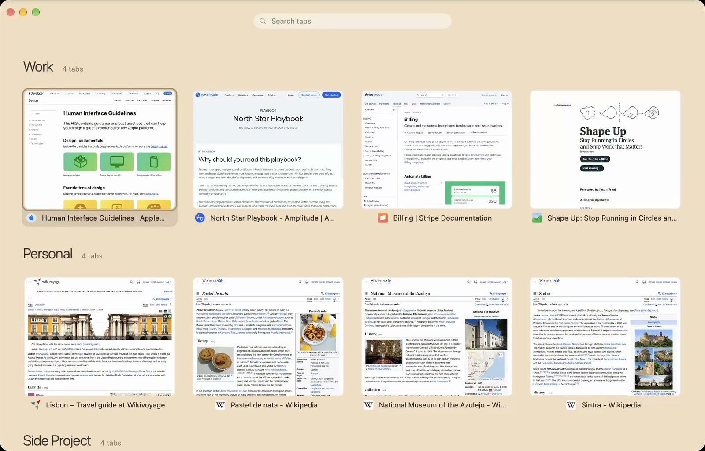
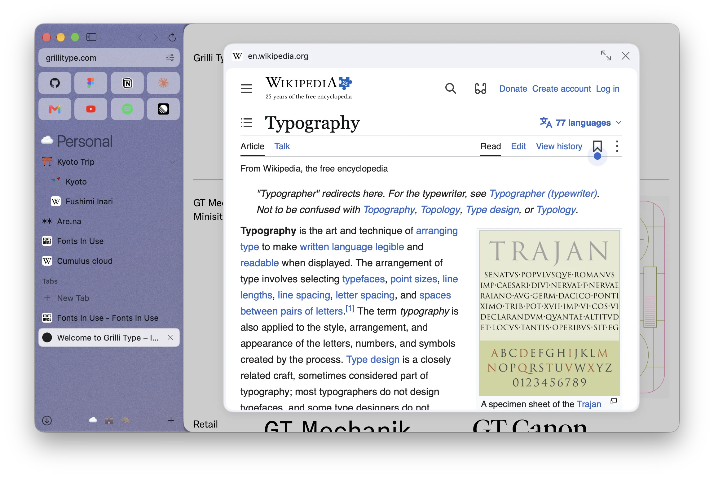
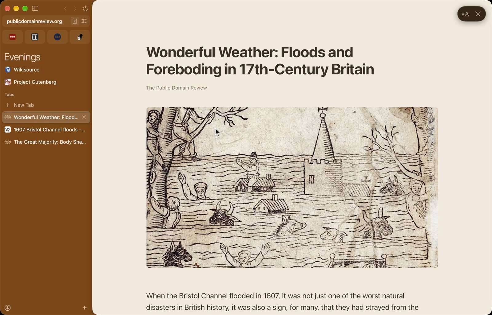

<p align="center">
  <a href="https://zigzagbrowser.com"></a>
</p>

<p align="center">
  <a href="https://zigzagbrowser.com/download"><b>Download for Mac</b></a><br>
  <sub>or <code>brew install --cask zigaowang/tap/zigzag</code></sub><br>
  <sub>Free. macOS 15.4 or later. In beta.</sub>
</p>

<p align="center">
  <a href="https://www.producthunt.com/products/zigzag-browser?embed=true&amp;utm_source=badge-featured&amp;utm_medium=badge&amp;utm_campaign=badge-zigzag-browser"></a>
</p>

<p align="center">
  Your tabs in a sidebar, grouped into spaces. A native Mac app in Swift on WebKit,<br>
  18 MB installed, with no account and no telemetry.
</p>

## Coming from Arc

**Your Arc comes with you.** File › Import from Another Browser…, pick Arc, and your spaces, pinned tabs, pinned folders, Favorites,
history, passwords, sign-ins and extensions come over. The pile of open tabs stays behind, so you start clean.

**1Password works.** Install it from the Chrome Web Store inside Zigzag, like you would in Arc. It talks to the
1Password app. The first time, add Zigzag in 1Password › Settings › Browser. Bitwarden works too.

**It can't be switched off.** There's no account, and Zigzag doesn't depend on a server of mine. The only thing I
host is the update feed, and if that went away, Zigzag would keep working. [Privacy](#privacy) lists everything
Zigzag connects to on its own.

## See it

<p align="center">
  
</p>

<table>
  <tr>
    <td width="50%"><br><b>Split View.</b> Drag a tab onto the page to open it beside.</td>
    <td width="50%"><br><b>Every tab at once.</b> ⇧⌘\ shows every space. Type to filter.</td>
  </tr>
  <tr>
    <td width="50%"><br><b>Peek.</b> Shift-click a link to glance at it without losing your place.</td>
    <td width="50%"><br><b>Reader.</b> Long reads, without the clutter.</td>
  </tr>
</table>

<p align="center"><sub>More, in motion, at <a href="https://zigzagbrowser.com">zigzagbrowser.com</a>.</sub></p>

## What it does

| | |
|---|---|
| **Spaces** | Each with its own color, icon, pinned tabs and folders. Swipe on the sidebar, or nudge the mouse wheel sideways, to switch. |
| **Favorites** | Your most used sites as tiles, above every space. |
| **Command bar** | ⌘T or ⌘L. Finds open tabs, history and sites. Type `you`, press Tab, and you're searching YouTube. |
| **Split view** | Drag a tab onto the page. Pin a split and it stays one. |
| **Peek** | Shift-click a link to read it over the page you're on. |
| **All tabs** | ⇧⌘\ shows every space at once. Type to filter, drag a tab to another space. |
| **Clear** | Closes the tabs you've drifted away from and keeps the ones you're working with. Undo brings them back. |
| **Zigzag Mini** | ⌃⌘N opens a small window for one quick page, and ⌘O moves it into your browser window. Links from other apps can open in it, like Little Arc. |
| **Passwords** | In your Mac's Keychain, synced by iCloud Keychain. Touch ID, a generator, and a check for weak and reused ones. Passkeys work. |
| **Ad blocking** | Built in and on: about 130,000 EasyList, EasyPrivacy and EasyList China rules, compiled into WebKit content rule lists. |
| **Extensions** | From the Chrome Web Store, with an Add to Zigzag button on each listing. 1Password, Bitwarden, Dark Reader, Tampermonkey and most popular ones work; see below for what doesn't. |
| **Import** | Bookmarks, history, passwords, sign-ins and extensions from Arc, Chrome, Safari, Dia, Edge, Brave, Vivaldi, Opera, Firefox and Zen. |
| **Automation** | AppleScript, Shortcuts and `osascript` can list and open tabs and read pages, written the way Safari and Chrome take them. See [docs/automation.md](docs/automation.md). |
| **Languages** | English and Simplified Chinese. |
| **And** | Reader, PDF viewer, full-page screenshots (⇧⌘2), on-device translation, Picture in Picture, private windows, Web Inspector. |

## What's missing

Zigzag is a beta. It's my everyday browser, but you'll find bugs. Things Arc users will notice:

- No sync between Macs or to iPhone. Passwords sync through iCloud Keychain; spaces and tabs don't.
- No separate profiles. Every space shares the same logins.
- Space icons don't come over from Arc; pick them again in Zigzag. Space colors come over as the nearest Zigzag color.
- No Boosts, Easels, Notes, or AI features.
- A few Chrome extension APIs aren't there yet: tab groups, debugger settings, Chrome's own Google account sign-in (`identity.getAuthToken`), and the old request-blocking webRequest. Proxy extensions can set a fixed HTTP, HTTPS or SOCKS5 proxy but not a PAC script, so FoxyProxy's Proxy by Patterns mode doesn't work.
- The ad blocking lists update with Zigzag, not on their own.
- macOS 15.4 or later only.

## How it's built

Zigzag is about 65,000 lines of Swift 6 and AppKit around `WKWebView`. There's no Chromium and no Electron: the
engine is the WebKit that ships with macOS, which is why the app is small and why engine security fixes arrive
with macOS updates rather than from me.

| Part | How |
|---|---|
| **Pages** | One `WKWebView` per tab. Tabs you haven't used in a while can be suspended: the web view is released and the tab keeps its snapshot and state, then reloads when you come back. Private windows use a non-persistent data store. |
| **Extensions** | WebKit's web extension support (`WKWebExtensionController`, the reason for the macOS 15.4 minimum). Zigzag downloads the CRX3 package from the Chrome Web Store, checks its signatures, and loads it. Chrome APIs WebKit doesn't have (history, bookmarks, downloads, notifications, side panels, offscreen pages, web sign-in, tab audio, new tab pages, user scripts, proxies and more) are answered by Zigzag itself through a small bridge, checked against each extension's own permissions. A search engine an extension gives (`search_provider`) joins the choices in Settings, used only once you pick it. Native messaging connects the helper apps of 1Password and other extensions. |
| **Ad blocking** | EasyList, EasyPrivacy and EasyList China converted ahead of time with SafariConverterLib into content rule lists (`WKContentRuleListStore`), compiled once and cached. |
| **Passwords** | Saved as Keychain items, so iCloud Keychain syncs them and Touch ID unlocks them. Passkeys go through Apple's browser passkey entitlement. Autofill is a small content script that only fills fields you can see. |
| **Import** | Reads each browser's own files: Arc's `StorableSidebar.json`, Chromium's bookmarks and SQLite history, Safari's `Bookmarks.plist`, Firefox's `places.sqlite`. Chromium passwords are decrypted with the key from that browser's Keychain item, after macOS asks you. |
| **Your data** | Spaces, pins and favorites in `Library.json`, open tabs in `Session.json`, history in SQLite, all under `~/Library/Application Support/Zigzag`. Writes are debounced and atomic, and a file that can't be read is set aside, never overwritten. |
| **Reader** | Mozilla's Readability, run in the page, shown in Zigzag's own typography. |
| **Updates** | Sparkle 2, with EdDSA-signed updates from zigzagbrowser.com. Releases are signed with Developer ID and notarized. |

The source is organized by feature: `Sidebar`, `Tabs`, `Web`, `Extensions`, `Passwords`, `Import`,
`CommandBar`, `Desk` (every tab at once), `Peek`, `Settings`, `Window` and `Design` (Zigzag's own drawn controls
and design tokens). About 400 tests cover importing, passwords, extensions, address handling, history and the
security fixes.

## Privacy

No account, no analytics, no telemetry. Nothing about how you browse is sent to me. These are the only
connections Zigzag makes on its own, apart from the pages you open:

- **Updates.** Once a day, Zigzag reads the update feed at zigzagbrowser.com. The request says Zigzag's version
  and nothing else; no system profile is sent. A new version downloads from there too.
- **Search suggestions.** As you type in the address bar, the text goes to your search engine for suggestions,
  without cookies. Google, DuckDuckGo, Brave, Bing, Kagi and Ecosia offer them; with any other engine, nothing is
  sent. Turn them off in Settings › Search.
- **Site icons.** Icons come from each site itself, also for pinned tabs, favorites and imported bookmarks you
  haven't opened yet.
- **Extensions.** Installing one downloads it from the Chrome Web Store. At launch, at most once a day, Zigzag
  asks the store whether your extensions have updates, which sends their IDs and versions to Google.
- **Setup.** The welcome screens show a few site icons from Google's icon service and load Wikipedia's front page
  as a preview.

Translation runs on your Mac, with Apple's on-device Translation. Fraudulent website warnings are WebKit's own,
the same as Safari's. Passwords stay in your Mac's Keychain and sync only through your own iCloud Keychain.
Help › Report a Problem writes a report you can read first, and nothing is sent unless you send it.

## Install

Download the DMG from [zigzagbrowser.com](https://zigzagbrowser.com/download), open it, and drag Zigzag to
Applications. Or, with Homebrew:

    brew install --cask zigaowang/tap/zigzag

Updates install by themselves. What changed in each version is in the
[release notes](https://zigzagbrowser.com/release-notes) and [CHANGELOG.md](CHANGELOG.md).

## Feedback

- **Bugs and ideas:** [open an issue](https://github.com/ZigaoWang/zigzag/issues/new/choose), or Help › Send Feedback… in the app. For a bug, Help › Report a Problem… writes a report you can read before you send it.
- **Email:** a@zigao.wang
- **Security problems:** see [SECURITY.md](SECURITY.md). Please don't post them in public issues.

## Build from source

Requirements: macOS 15.4 or later, Xcode 26 or later, and [XcodeGen](https://github.com/yonaskolb/XcodeGen).

```sh
brew install xcodegen
git clone https://github.com/ZigaoWang/zigzag.git
cd zigzag
xcodegen generate
open Zigzag.xcodeproj
```

Run the **Zigzag** scheme. Debug builds run as a separate app, "Zigzag Dev", with their own data, so they never
touch your everyday Zigzag.

Signing is set up for my team. To build on your Mac, change two things in `project.yml` and run
`xcodegen generate` again:

- `DEVELOPMENT_TEAM`: your own team ID (Xcode › Settings › Accounts shows it).
- The Debug `PRODUCT_BUNDLE_IDENTIFIER`: one of your own, such as `com.yourname.zigzag.dev`, since
  `wang.zigao.zigzag.dev` is registered to my team.

Run the tests:

```sh
xcodebuild test -project Zigzag.xcodeproj -scheme Zigzag
```

## Contributing

Contributions are welcome. Read [CONTRIBUTING.md](CONTRIBUTING.md) for how the project is built, tested and
styled.

## License

Zigzag's code is licensed under the [Apache License, Version 2.0](LICENSE). Use it, change it, fork it and ship
it, commercially or not.

The name "Zigzag", the app icon and the logo are not covered by the license: they're trademarks, all rights
reserved. A fork needs its own name and icon. See [TRADEMARKS.md](TRADEMARKS.md) and [NOTICE](NOTICE).
Third-party work Zigzag uses is listed in [THIRD_PARTY_NOTICES.md](THIRD_PARTY_NOTICES.md).

## Acknowledgments

Thanks to the [LINUX DO](https://linux.do) community for trying Zigzag early and sharing their feedback.

<p align="center">
  <a href="https://linux.do"></a>
</p>
