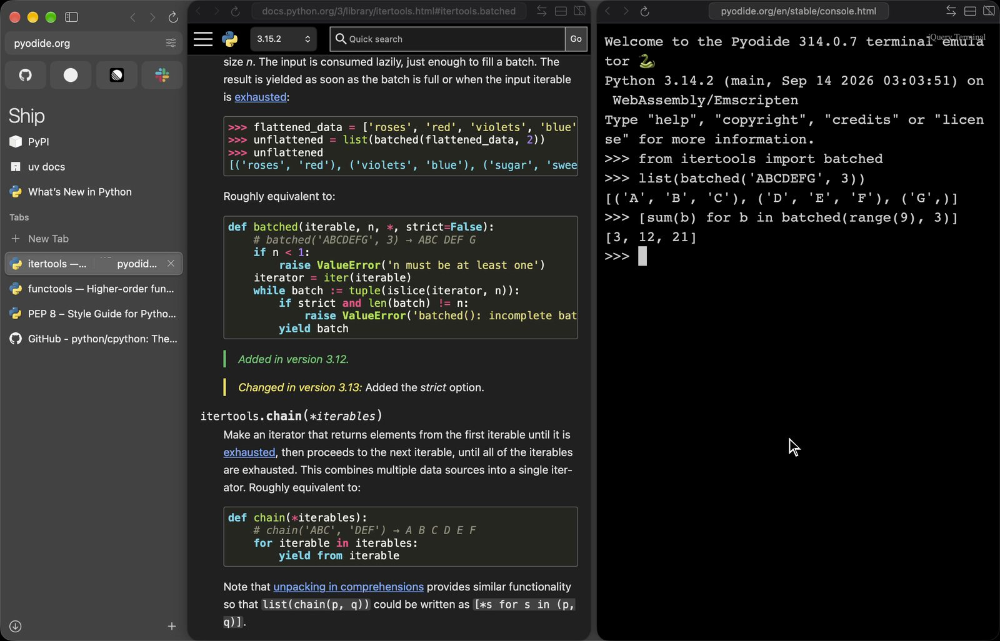

<p align="center">
  <a href="https://zigzagbrowser.com"></a>
</p>

<div align="center">

<p align="center"><sub><a href="../../README.md">English</a> | <a href="README.zh-Hans.md">简体中文</a> | <a href="README.zh-Hant.md">繁體中文</a> | <a href="README.ja.md">日本語</a> | <a href="README.ko.md">한국어</a> | <a href="README.de.md">Deutsch</a> | Français | <a href="README.it.md">Italiano</a> | <a href="README.es.md">Español</a> | <a href="README.pt-BR.md">Português (Brasil)</a> | <a href="README.ru.md">Русский</a> | <a href="README.nl.md">Nederlands</a> | <a href="README.pl.md">Polski</a> | <a href="README.tr.md">Türkçe</a></sub></p>

Cette page est une traduction de README.md ; si elles diffèrent, la version anglaise fait foi.

</div>

<p align="center">
  <a href="https://zigzagbrowser.com/download"><b>Télécharger pour Mac</b></a><br>
  <sub>ou <code>brew install --cask zigaowang/tap/zigzag</code></sub><br>
  <sub>Gratuit et open source. macOS 15.4 ou version ultérieure.</sub>
</p>

<p align="center">
  Vos onglets dans une barre latérale, regroupés en espaces. Une app Mac native en Swift sur WebKit,<br>
  environ 35 Mo installée, sans compte et sans télémétrie.
</p>

## Pourquoi je l’ai créé

Salut, je m’appelle Zigao, je suis lycéen à Shanghai. J’utilisais Arc tous les jours. Quand The Browser Company a annoncé qu’elle arrêtait Arc le 22 décembre, je ne voulais vraiment pas revenir à des onglets en haut de la fenêtre, et les alternatives que j’ai essayées étaient soit des forks de Chromium, soit des navigateurs construits autour de l’IA. Alors j’ai fait le mien, et c’est mon navigateur principal depuis.

**Pourquoi WebKit et pas Chromium ?** J’ai en fait commencé par forker Helium. Le code source faisait environ 100 Go et chaque compilation prenait 3 à 4 heures sur mon Mac, ce que je ne peux pas tenir tout seul. WebKit est déjà fourni avec macOS, il ménage mieux la batterie et la mémoire, et Apple livre ses correctifs de sécurité avec les mises à jour de macOS. Vous gardez quand même les extensions Chrome, installées directement depuis le Chrome Web Store.

**Pourquoi pas Zen ou Orion ?** J’ai essayé les deux avant de me lancer, et ils sont bons. Zen repose sur Firefox, donc il utilise les extensions Firefox et ne me donne pas l’impression d’une app Mac. Orion s’en approche davantage, mais il n’est pas open source. Je voulais un navigateur qui fonctionne comme Arc, qui soit natif, open source, et qui fasse tourner mes extensions Chrome.

## Si vous venez d’Arc

**Votre Arc vous suit.** Fichier › Importer depuis un autre navigateur…, choisissez Arc, et vos espaces, onglets épinglés, dossiers épinglés, favoris, historique, mots de passe, connexions et extensions sont importés. Vos onglets ouverts peuvent venir aussi, Split View comprises, et attendent que vous cliquiez dessus pour se charger ; décochez Onglets ouverts pour repartir de zéro. Si vos espaces sont répartis sur plusieurs profils Arc, chaque profil Arc devient un profil Zigzag à part.

**1Password fonctionne.** Installez-le depuis le Chrome Web Store dans Zigzag, comme vous le feriez dans Arc. Il communique avec l’app 1Password. La première fois, ajoutez Zigzag dans 1Password › Réglages › Navigateur. Bitwarden fonctionne aussi.

**On ne peut pas vous le retirer.** Il n’y a pas de compte, et Zigzag ne dépend d’aucun serveur à moi. Je n’héberge que le flux des mises à jour et une courte liste de correctifs pour le blocage des publicités, et s’ils disparaissaient, Zigzag continuerait de fonctionner. [Confidentialité](#confidentialité) liste toutes les connexions que Zigzag établit de lui-même.

## Aperçu

<p align="center">
  
</p>

<table>
  <tr>
    <td width="50%"><br><b>Split View.</b> Faites glisser un onglet sur la page pour l’ouvrir à côté, jusqu’à quatre à la fois.</td>
    <td width="50%"><br><b>Tous les onglets d’un coup.</b> ⇧⌘\ affiche tous les espaces. Tapez pour filtrer.</td>
  </tr>
  <tr>
    <td width="50%"><br><b>Zigzag Mini.</b> Cliquez sur un lien en maintenant Maj pour y jeter un œil sans perdre votre place.</td>
    <td width="50%"><br><b>Lecteur.</b> Les longues lectures, sans le fouillis.</td>
  </tr>
</table>

<p align="center"><sub>Plus d’exemples, en mouvement, sur <a href="https://zigzagbrowser.com">zigzagbrowser.com</a>.</sub></p>

## Ce qu’il fait

| | |
|---|---|
| **Espaces** | Chacun avec sa couleur, son icône, ses onglets épinglés et ses dossiers. Balayez sur la barre latérale, ou poussez la molette de la souris sur le côté, pour changer d’espace. |
| **Favoris** | Vos sites les plus utilisés sous forme de tuiles, au-dessus de chaque espace. Chaque onglet, onglet épinglé ou favori peut porter son propre emoji ou symbole. |
| **Profils** | Séparez le travail et le personnel. Chaque profil a ses propres extensions, connexions, historique et favoris, et chaque espace appartient à un profil. |
| **Sites dans des espaces** | Choisissez un espace pour un site dans Réglages du site ou dans Réglages › Espaces, et ses liens s’y ouvrent d’où qu’ils viennent : une autre app, ⌘T ou un autre espace, comme avec l’Air Traffic Control d’Arc. Des chemins peuvent aussi aller vers leurs propres espaces, par exemple `github.com/org1` vers l’un et `github.com/org2` vers un autre. Un espace sur son propre profil fonctionne comme un conteneur Firefox. |
| **Barre de commandes** | ⌘T ou ⌘L. Trouve les onglets ouverts, l’historique et les sites. Tapez `you`, appuyez sur Tab, et vous cherchez sur YouTube. Faites glisser la barre où vous voulez dans la fenêtre et elle s’ouvrira désormais à cet endroit. |
| **Groupes d’onglets** | Sélectionnez des onglets et choisissez Grouper les onglets : ils deviennent un dossier dans la barre latérale qui s’ouvre et se ferme, se renomme et se déplace d’un bloc. Faites glisser un onglet vers la droite pour l’imbriquer sous l’onglet du dessus, et vers la gauche pour l’en sortir. |
| **Dossiers dynamiques** | Un dossier épinglé qui se remplit tout seul à partir d’un flux ou d’un site, ou de GitHub : pull requests, demandes de relecture, ou issues et pull requests ouvertes de vos dépôts. Les nouvelles pages arrivent avec un point. |
| **Split View** | Jusqu’à quatre onglets : faites glisser un onglet sur les bords de la page pour une moitié, ou sur ses coins pour un quart. Faites glisser une page par sa bande pour la déplacer, et épinglez une Split View pour la garder. |
| **Fenêtres** | Faites glisser un onglet vers une autre fenêtre et il s’y déplace tel quel, sans se recharger. Activez Réglages › Onglets › Les fenêtres partagent les onglets d’un espace et chaque fenêtre sur un espace affiche les mêmes onglets, comme dans Arc. La barre latérale se place à gauche ou à droite. |
| **Apps web** | Installer en tant qu’app fait d’un site une app à part entière, dans votre dossier Applications, le Dock et ⌘Tab, avec une barre d’outils de la couleur du site. |
| **Mini-lecteur** | Quittez un onglet pendant qu’une vidéo est lue et la vidéo vous suit dans un petit lecteur. Redimensionnez-le depuis n’importe quel bord et placez-le où vous voulez, même hors de la fenêtre, par-dessus d’autres apps. Désactivez-le depuis son menu si vous n’en voulez pas. Passez à une autre app et la vidéo flotte par-dessus en Image dans l’image. |
| **Streaming** | La musique et la vidéo protégées se lisent comme dans Safari, via FairPlay Streaming de WebKit : le lecteur web de Spotify fonctionne, de même que d’autres services compatibles avec Safari. |
| **En cours de lecture** | Chaque onglet qui joue du son en arrière-plan reçoit une carte au bas de la barre latérale, jusqu’à trois, pour le mettre en pause ou couper le son. |
| **Tous les onglets** | ⇧⌘\ affiche tous les espaces à la fois. Tapez pour filtrer, faites glisser un onglet vers un autre espace. |
| **Effacer** | Ferme les onglets que vous avez délaissés et garde ceux avec lesquels vous travaillez. Pointez-le pour voir ceux qu’il fermerait. Une Split View reste ou part d’un bloc. Annuler les ramène. |
| **Zigzag Mini** | ⌃⌘N ouvre une petite fenêtre pour une page rapide, et ⌘O la déplace dans la fenêtre de votre navigateur. Cliquez sur un lien en maintenant Maj, ou choisissez Ouvrir le lien dans Zigzag Mini, et il s’ouvre dans une fenêtre de ce type par-dessus la vôtre ; ⌘O le place dans un onglet à côté de celui où vous avez cliqué, et Échap le ferme. Les liens d’autres apps s’y ouvrent, comme avec Little Arc (désactivez cela dans Réglages › Zigzag Mini), et Ouvrir dans Zigzag Mini y déplace un onglet. |
| **Mots de passe** | Dans le trousseau de votre Mac, synchronisés par le Trousseau iCloud. Touch ID, un générateur, et une vérification des mots de passe faibles et réutilisés. Les clés d’identification fonctionnent. |
| **Pages sombres** | Les sites clairs affichés en sombre par le moteur de Dark Reader, avec ses correctifs pour des milliers de sites, pour que les photos restent fidèles. Les sites qui ont leur propre mode sombre le gardent. Noir pur si vous le préférez plus sombre. Partout ou site par site. |
| **Blocage des publicités** | Intégré et activé : environ 130 000 règles EasyList, EasyPrivacy et EasyList China, compilées en listes de règles de contenu WebKit, plus les listes de filtres d’uBlock Origin, qui se mettent à jour toutes seules. |
| **WebRTC** | Activez Protéger l’adresse IP contre WebRTC, et les sites ne peuvent plus découvrir votre vraie adresse IP via WebRTC pendant que vous utilisez un proxy ou un VPN. Les appels fonctionnent sur les sites que vous autorisez, et un site qui essaie WebRTC alors qu’il est bloqué vous le signale, avec Autoriser pour ce site. |
| **Bannières de cookies** | Refusées à votre place, jamais acceptées, avec les règles Autoconsent de DuckDuckGo. Ne rien faire partout ou pour un seul site si vous préférez répondre vous-même. |
| **Réglages du site** | Un panneau par site : zoom, autorisations (caméra, micro, position, notifications, fenêtres surgissantes, ouverture d’apps, partage d’écran, WebRTC), chacune réglée sur Demander, Autoriser ou Bloquer, JavaScript activé ou désactivé, le certificat, les extensions, et des interrupteurs pour les pages sombres, le blocage des publicités et les bannières de cookies. Quand un site demande l’une de ces autorisations, il le fait sur une seule carte au-dessus de la page, pour cette fois ou pour toujours, et un site à qui vous avez dit non cesse de demander. |
| **Boosts** | Masquer des éléments cache les parties d’un site dont vous ne voulez pas, comme une bannière ou une barre latérale, et Modifier le style donne à un site du CSS de votre cru. Les deux se trouvent dans le menu ⋯ de Réglages du site et restent attachés au site. |
| **Mode développeur** | Pour les sites que vous construisez, `localhost` pour commencer : la console avec un compteur d’erreurs, Inspecter l’élément, les tailles d’appareil, clair et sombre, les styles d’impression, JavaScript, images ou styles désactivés, un autre agent utilisateur, et un code QR pour ouvrir la page sur votre téléphone. |
| **Extensions** | Depuis le Chrome Web Store, où le bouton du store lui-même indique Ajouter à Zigzag. 1Password, Bitwarden, Dark Reader, Tampermonkey et la plupart des extensions populaires fonctionnent ; voyez plus bas ce qui ne fonctionne pas. |
| **Importer** | Signets, historique, mots de passe, connexions et extensions depuis Arc, Chrome, Safari, Dia, Edge, Brave, Vivaldi, Opera, Comet, Helium, Yandex, Whale, Chromium, Thorium, Firefox, Zen et Orion. |
| **Téléchargements** | Envoyez les fichiers d’un type vers un dossier à part, ou ouvrez ceux qui sont sûrs, comme les PDF, une fois enregistrés. Des règles transfèrent un lien ou un téléchargement à une app, à un script ou à un gestionnaire de téléchargement comme aria2, en vous demandant d’abord. Voir [docs/download-rules.md](../../docs/download-rules.md). |
| **Automatisation** | AppleScript, Raccourcis et `osascript` peuvent lister et ouvrir des onglets et lire des pages, écrits comme le prennent Safari et Chrome. Voir [docs/automation.md](../../docs/automation.md). |
| **Apps d’IA** | Désactivé tant que vous ne l’activez pas : les apps d’IA de votre Mac peuvent utiliser vos onglets via MCP, jamais les fenêtres privées ni les mots de passe. Voir [docs/automation.md](../../docs/automation.md#ai-apps-mcp). |
| **Vos données** | Fichier › Exporter vos données… enregistre vos signets dans un fichier HTML standard que tout navigateur sait importer, ainsi qu’une sauvegarde complète de Zigzag que vous pouvez restaurer sur un autre Mac. |
| **Langues** | Anglais, chinois simplifié, chinois traditionnel, japonais, coréen, allemand, français, italien, espagnol, portugais brésilien, russe, néerlandais, polonais et turc. |
| **Et aussi** | Lecteur, lecteur de PDF, Handoff vers votre iPhone, iPad ou un autre Mac, Capture d’une zone, d’une partie de la page ou de la page entière (⇧⌘2), traduction sur l’appareil, recherche dans la page qui marque chaque occurrence, un menu Historique avec Récemment fermés et les sept derniers jours, un zoom de page par défaut, une barre d’adresse au-dessus de la page si vous préférez, Image dans l’image, fenêtres privées, Inspecteur web. |

## Ce qui manque

C’est mon navigateur de tous les jours, mais Zigzag est jeune et vous y trouverez des bugs. Ce que les utilisateurs d’Arc remarqueront :

- Pas de synchronisation entre Mac ni vers l’iPhone. Les mots de passe se synchronisent par le Trousseau iCloud ; les espaces et les onglets, non.
- Les icônes d’espaces ne viennent pas d’Arc ; choisissez-les de nouveau dans Zigzag. Les couleurs d’espaces sont importées sous la forme de la couleur Zigzag la plus proche.
- Pas d’Easels ni de Notes, et les Boosts sont limités au CSS (Masquer des éléments et Modifier le style, pas de scripts par site). Pas d’IA intégrée au navigateur : les apps d’IA ne peuvent utiliser Zigzag que via MCP, et seulement si vous l’activez.
- Quelques API d’extensions Chrome ne sont pas encore là : l’API des groupes d’onglets, les réglages du débogueur, la connexion au compte Google propre à Chrome (`identity.getAuthToken`), et l’ancien blocage de requêtes webRequest. Les extensions de proxy peuvent définir un proxy HTTP, HTTPS ou SOCKS5 fixe, mais pas un script PAC, donc le mode Proxy by Patterns de FoxyProxy ne fonctionne pas.
- EasyList et les autres listes de blocage intégrées se mettent à jour avec Zigzag, pas toutes seules ; seules les listes d’uBlock Origin le font.
- macOS 15.4 ou version ultérieure uniquement.

## Comment il est construit

Zigzag compte environ 120 000 lignes de Swift 6 et d’AppKit autour de `WKWebView`. Il n’y a ni Chromium ni Electron : le moteur est le WebKit fourni avec macOS, ce qui explique que l’app soit petite et que les correctifs de sécurité du moteur arrivent avec les mises à jour de macOS plutôt que de moi.

| Partie | Comment |
|---|---|
| **Pages** | Une `WKWebView` par onglet. Les onglets que vous n’avez pas utilisés depuis un moment peuvent être suspendus : la vue web est libérée et l’onglet garde son instantané et son état, puis se recharge quand vous y revenez. Les fenêtres privées utilisent un stockage de données non persistant. |
| **Extensions** | La prise en charge des extensions web de WebKit (`WKWebExtensionController`, la raison du minimum macOS 15.4). Zigzag télécharge le paquet CRX3 depuis le Chrome Web Store, vérifie ses signatures et le charge. Les API Chrome que WebKit n’a pas (historique, signets, téléchargements, notifications, panneaux latéraux, pages hors écran, connexion web, audio des onglets, pages Nouvel onglet, scripts utilisateur, proxys, et plus) sont gérées par Zigzag lui-même au moyen d’un petit pont, vérifiées par rapport aux autorisations propres à chaque extension. Un moteur de recherche fourni par une extension (`search_provider`) rejoint les choix des Réglages, utilisé seulement quand vous le choisissez. La messagerie native relie les apps auxiliaires de 1Password et d’autres extensions. |
| **Isolation** | Les images et les PDF des sites web sont lus dans deux assistants XPC isolés, `ZigzagImageDecoder` et `ZigzagPDFRenderer`, sans réseau ni accès aux fichiers, de sorte qu’une image ou un PDF malformé ne peut pas atteindre vos mots de passe ni vos profils. Le lecteur de PDF affiche les pages que l’assistant génère ; l’app n’ouvre jamais elle-même le PDF d’un site. |
| **Connexions sécurisées** | Les avertissements de certificat disent ce qui ne va pas sous Détails. Un site qui a demandé les connexions sécurisées uniquement, par son en-tête HSTS ou sur la liste de préchargement de Chromium (intégrée, environ 95 000 noms, lue sur place seulement quand un avertissement l’exige), n’a pas de Consulter ce site quand même, comme dans Safari et Chrome. Un site qui demande un certificat pour vous identifier se voit proposer ceux de votre trousseau qu’il accepterait, comme dans Safari : ajoutez-en un en ouvrant son .p12 dans Accès au trousseau. |
| **Blocage des publicités** | EasyList, EasyPrivacy et EasyList China converties à l’avance avec SafariConverterLib en listes de règles de contenu (`WKContentRuleListStore`), compilées une fois et mises en cache. Les listes d’uBlock Origin, téléchargées à mesure qu’elles expirent, sont appliquées par le moteur adblocker de Ghostery dans son propre contexte JavaScript, et chaque page reçoit les scriptlets et les règles de masquage dont son site a besoin au début de son chargement. |
| **Pages sombres** | Le thème dynamique de Dark Reader et ses correctifs de sites, intégrés, dans un monde de scripts à part. Les pages apprennent d’abord que la fenêtre est sombre, si bien qu’un site avec son propre thème sombre l’utilise et est laissé tranquille. |
| **Bannières de cookies** | Autoconsent de DuckDuckGo et ses règles, intégrés, dans un monde de scripts à part. |
| **Mots de passe** | Enregistrés comme éléments du trousseau, donc le Trousseau iCloud les synchronise et Touch ID les déverrouille. Les clés d’identification passent par le droit d’accès aux clés d’identification des navigateurs d’Apple. Le remplissage automatique est un petit script de contenu qui ne remplit que les champs que vous voyez. |
| **Importer** | Lit les fichiers propres à chaque navigateur : `StorableSidebar.json` d’Arc, les signets de Chromium et son historique SQLite, `Bookmarks.plist` de Safari, `places.sqlite` de Firefox, `favourites.plist` et `history` d’Orion. Les mots de passe de Chromium sont déchiffrés avec la clé de l’élément de trousseau de ce navigateur, après que macOS vous l’a demandé. |
| **Vos données** | Espaces, épinglés et favoris dans `Library.json`, profils dans `Profiles.json`, onglets ouverts dans `Session.json`, historique dans SQLite (un fichier par profil), le tout sous `~/Library/Application Support/Zigzag`. Les écritures sont regroupées et atomiques, et un fichier illisible est mis de côté, jamais écrasé. |
| **Lecteur** | Readability de Mozilla, exécuté dans la page, affiché avec la typographie propre à Zigzag. |
| **Apps web** | Un site installé en tant qu’app est une petite app à part entière dans `~/Applications/Zigzag Apps` qui confie chaque lancement à Zigzag, de sorte que la page s’exécute dans Zigzag avec vos connexions, vos extensions et le blocage. |
| **Mises à jour** | Sparkle 2, avec des mises à jour signées EdDSA depuis zigzagbrowser.com, sur un flux stable ou bêta. Les versions sont signées avec Developer ID et notarisées. |

Le code source est organisé par fonctionnalité : `Sidebar`, `Tabs`, `Web`, `Extensions`, `Passwords`, `Import`, `Profiles`, `CommandBar`, `Desk` (tous les onglets d’un coup), `WebApps`, `Developer`, `MCP` (apps d’IA), `Settings`, `Window` et `Design` (les contrôles dessinés par Zigzag et ses variables de design). Plus de 2 000 tests couvrent l’importation, les mots de passe, les extensions, le traitement des adresses, l’historique, les apps d’IA et les correctifs de sécurité.

## Confidentialité

Pas de compte, pas d’analyses, pas de télémétrie. Rien sur votre façon de naviguer ne m’est envoyé. Ce sont les seules connexions que Zigzag établit de lui-même, en dehors des pages que vous ouvrez :

- **Mises à jour.** Toutes les quelques heures, et après la sortie de veille de votre Mac, Zigzag lit le flux des mises à jour sur zigzagbrowser.com. La requête indique la version de Zigzag et rien d’autre ; aucun profil système n’est envoyé. Une nouvelle version se télécharge aussi depuis cet endroit.
- **Suggestions de recherche.** Pendant que vous tapez dans la barre d’adresse, le texte est envoyé à votre moteur de recherche pour obtenir des suggestions, sans cookies. Google, DuckDuckGo, Brave, Bing, Kagi et Ecosia en proposent ; avec tout autre moteur, rien n’est envoyé. Désactivez-les dans Réglages › Recherche.
- **Icônes de sites.** Les icônes viennent de chaque site lui-même, y compris pour les onglets épinglés, les favoris et les signets importés que vous n’avez pas encore ouverts.
- **Listes de filtres.** Au lancement puis à mesure qu’elles expirent, toutes les quelques heures à une fois par jour, Zigzag télécharge les listes de filtres d’uBlock Origin depuis les adresses d’uBlock Origin lui-même (GitHub Pages, Cloudflare Pages ou jsDelivr) et ses scriptlets depuis le CDN de Ghostery. Il télécharge aussi la courte liste de correctifs de sites propre à Zigzag depuis zigzagbrowser.com. Les requêtes ne contiennent pas de cookies, ni rien sur vous ou sur votre navigation.
- **Extensions.** En installer une la télécharge depuis le Chrome Web Store. Au lancement, au plus une fois par jour, Zigzag demande au store si vos extensions ont des mises à jour, ce qui envoie leurs identifiants et leurs versions à Google.
- **Configuration.** Les écrans de bienvenue affichent quelques icônes de sites provenant du service d’icônes de Google et chargent la page d’accueil de Wikipédia comme aperçu.

La traduction s’exécute sur votre Mac, avec la Traduction sur l’appareil d’Apple. Les avertissements de sites web frauduleux sont ceux de WebKit, les mêmes que ceux de Safari. Les mots de passe restent dans le trousseau de votre Mac et ne se synchronisent que par votre propre Trousseau iCloud. Aide › Signaler un problème écrit un rapport que vous pouvez lire d’abord, et rien n’est envoyé tant que vous ne l’envoyez pas. La liste Mots de passe du Mac garde un petit journal de ses étapes dans `~/Library/Logs/Zigzag/passwords.log`, jamais un identifiant ni un site, et il reste sur votre Mac. Votre carte Zigzag est créée sur votre Mac à partir du nom de votre compte et du jour du premier lancement de Zigzag, et son image ne contient que ce que la carte montre.

## Installation

Téléchargez le DMG depuis [zigzagbrowser.com](https://zigzagbrowser.com/download), ouvrez-le et faites glisser Zigzag dans Applications. Ou, avec Homebrew :

    brew install --cask zigaowang/tap/zigzag

Les mises à jour s’installent toutes seules. Ce qui a changé dans chaque version figure dans les [notes de version](https://zigzagbrowser.com/release-notes) et dans [CHANGELOG.md](../../CHANGELOG.md).

## Retours

- **Bugs et idées :** [ouvrez une issue](https://github.com/ZigaoWang/zigzag/issues/new/choose), ou Aide › Envoyer des commentaires… dans l’app. Pour un bug, Aide › Signaler un problème… écrit un rapport que vous pouvez lire avant de l’envoyer.
- **E-mail :** a@zigao.wang
- **Problèmes de sécurité :** voir [SECURITY.md](../../SECURITY.md). Ne les publiez pas dans des issues publiques.

## Compiler depuis les sources

Prérequis : macOS 15.4 ou version ultérieure, Xcode 27 ou version ultérieure, et [XcodeGen](https://github.com/yonaskolb/XcodeGen).

```sh
brew install xcodegen
git clone https://github.com/ZigaoWang/zigzag.git
cd zigzag
xcodegen generate
open Zigzag.xcodeproj
```

Lancez le schéma **Zigzag**. Les builds Debug s’exécutent comme une app séparée, « Zigzag Dev », avec leurs propres données, de sorte qu’ils ne touchent jamais à votre Zigzag de tous les jours.

La signature est configurée pour mon équipe. Pour compiler sur votre Mac, modifiez deux choses dans `project.yml` et relancez `xcodegen generate` :

- `DEVELOPMENT_TEAM` : l’identifiant de votre propre équipe (Xcode › Settings › Accounts le montre).
- Le `PRODUCT_BUNDLE_IDENTIFIER` de Debug : un identifiant à vous, comme `com.yourname.zigzag.dev`, puisque `wang.zigao.zigzag.dev` est enregistré pour mon équipe.

Lancez les tests :

```sh
xcodebuild test -project Zigzag.xcodeproj -scheme Zigzag
```

## Contribuer

Les contributions sont les bienvenues. Lisez [CONTRIBUTING.md](../../CONTRIBUTING.md) pour savoir comment le projet est construit, testé et mis en forme.

## Licence

Le code de Zigzag est sous [licence Apache, version 2.0](../../LICENSE). Utilisez-le, modifiez-le, forkez-le et distribuez-le, à titre commercial ou non.

Le nom « Zigzag », l’icône de l’app et le logo ne sont pas couverts par la licence : ce sont des marques déposées, tous droits réservés. Un fork a besoin de son propre nom et de sa propre icône. Voir [TRADEMARKS.md](../../TRADEMARKS.md) et [NOTICE](../../NOTICE). Les travaux tiers utilisés par Zigzag sont listés dans [THIRD_PARTY_NOTICES.md](../../THIRD_PARTY_NOTICES.md).

## Remerciements

Merci à la communauté [LINUX DO](https://linux.do) d’avoir essayé Zigzag très tôt et d’avoir partagé ses retours.

<p align="center">
  <a href="https://linux.do"></a>
</p>
