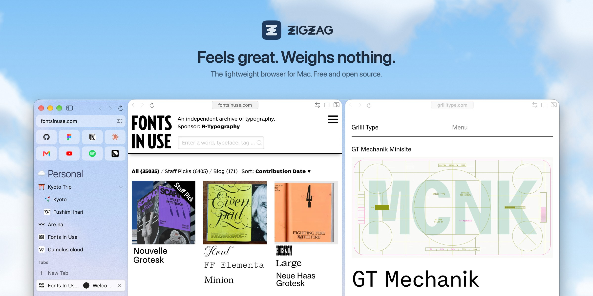
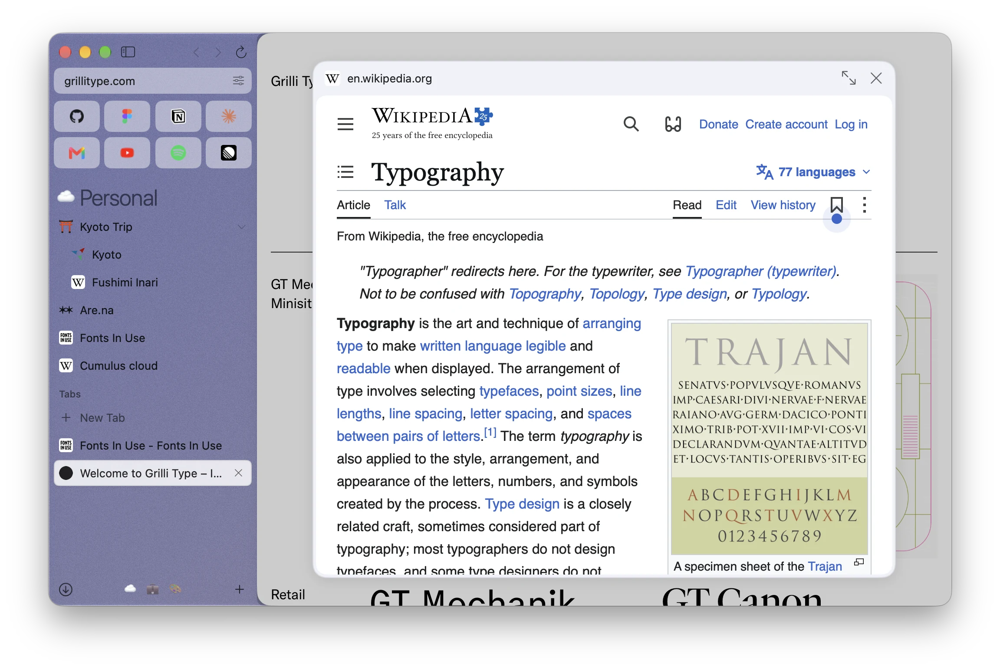

<p align="center">
  <a href="https://zigzagbrowser.com"></a>
</p>

<div align="center">

<p align="center"><sub><a href="../../README.md">English</a> | <a href="README.zh-Hans.md">简体中文</a> | <a href="README.zh-Hant.md">繁體中文</a> | <a href="README.ja.md">日本語</a> | <a href="README.ko.md">한국어</a> | <a href="README.de.md">Deutsch</a> | <a href="README.fr.md">Français</a> | <a href="README.it.md">Italiano</a> | <a href="README.es.md">Español</a> | <a href="README.pt-BR.md">Português (Brasil)</a> | <a href="README.ru.md">Русский</a> | <a href="README.nl.md">Nederlands</a> | <a href="README.pl.md">Polski</a> | Türkçe</sub></p>

Bu sayfa README.md dosyasının çevirisidir; aralarında fark olursa başvuru kaynağı İngilizce sürümdür.

</div>

<p align="center">
  <a href="https://zigzagbrowser.com/download"><b>Mac için indir</b></a><br>
  <sub>veya <code>brew install --cask zigaowang/tap/zigzag</code></sub><br>
  <sub>Ücretsiz ve açık kaynak. macOS 15.4 veya sonrası gerekir.</sub>
</p>

<p align="center">
  Sekmeleriniz kenar çubuğunda, Space’lere ayrılmış durumda. WebKit üzerinde Swift ile yazılmış yerel bir Mac uygulaması,<br>
  kurulu hâlde yaklaşık 35 MB; hesap yok, telemetri yok.
</p>

## Neden yaptım

Merhaba, ben Zigao, Şanghay’da lise öğrencisiyim. Her gün Arc kullanıyordum. The Browser Company, Arc’ı 22 Aralık’ta kapatacağını açıklayınca, sekmelerin üstte durduğu düzene dönmek istemedim; denediğim alternatifler de ya Chromium türevleriydi ya da yapay zekâ etrafında kurulmuş tarayıcılardı. Ben de kendiminkini yaptım ve o günden beri ana tarayıcım olarak kullanıyorum.

**Neden Chromium değil de WebKit?** Aslında Helium’u çatallayarak başladım. Kaynak kodu yaklaşık 100 GB’tı ve Mac’imde her derleme 3 ila 4 saat sürüyordu; bunu tek başıma sürdüremezdim. WebKit zaten macOS ile birlikte geliyor, pil ve bellekte daha hafif, güvenlik düzeltmelerini de Apple macOS güncellemeleriyle dağıtıyor. Chrome genişletmeleri de yine de var: doğrudan Chrome Web Store’dan kuruluyor.

**Neden Zen veya Orion değil?** Bu işe başlamadan önce ikisini de denedim, ikisi de iyi. Zen, Firefox üzerinde çalışıyor; yani Firefox genişletmeleri kullanıyor ve bana göre bir Mac uygulaması gibi hissettirmiyor. Orion daha yakın, ama açık kaynak değil. Ben Arc gibi çalışan, yerel hissettiren, açık kaynak olan ve Chrome genişletmelerimi çalıştıran bir şey istedim.

## Arc’ten geliyorsanız

**Arc’iniz sizinle gelir.** Dosya › Başka Bir Tarayıcıdan İçe Aktar…’ı seçin, Arc’ı işaretleyin; Space’leriniz, sabitlenmiş sekmeleriniz, sabitlenmiş klasörleriniz, Favorileriniz, geçmişiniz, parolalarınız, girişleriniz ve genişletmeleriniz aktarılır. Açık sekmeleriniz de, bölünmüş görünümleriyle birlikte gelebilir ve siz tıklayana kadar yüklenmez; temiz başlamak için “Açık Sekmeler”in işaretini kaldırın. Space’leriniz birden fazla Arc profilindeyse, her Arc profili Zigzag’de ayrı bir profil olarak gelir.

**1Password çalışır.** Arc’te yaptığınız gibi, Zigzag içinde Chrome Web Store’dan kurun. 1Password uygulamasıyla konuşur. İlk seferde Zigzag’i 1Password › Settings › Browser bölümünden ekleyin. Bitwarden da çalışır.

**Kapatılamaz.** Hesap yok ve Zigzag benim bir sunucuma bağımlı değil. Barındırdığım tek şeyler güncelleme akışı ve reklam engelleme düzeltmelerinin kısa bir listesi; ikisi de ortadan kalksa Zigzag çalışmaya devam eder. [Gizlilik](#gizlilik) bölümü, Zigzag’in kendi kendine bağlandığı her yeri listeler.

## Görün

<p align="center">
  
</p>

<table>
  <tr>
    <td width="50%"><br><b>Bölünmüş Görünüm.</b> Bir sekmeyi sayfanın üzerine sürükleyin, yanında açılsın; aynı anda dörde kadar.</td>
    <td width="50%"><br><b>Tüm sekmeler bir arada.</b> ⇧⌘\ her Space’i gösterir. Süzmek için yazın.</td>
  </tr>
  <tr>
    <td width="50%"><br><b>Zigzag Mini.</b> Yerinizi kaybetmeden bir bağlantıya göz atmak için tıklarken Shift’e basın.</td>
    <td width="50%"><br><b>Okuyucu.</b> Uzun okumalar, kalabalık olmadan.</td>
  </tr>
</table>

<p align="center"><sub>Daha fazlası, hareketli olarak, <a href="https://zigzagbrowser.com">zigzagbrowser.com</a> adresinde.</sub></p>

## Neler yapar

| | |
|---|---|
| **Space’ler** | Her birinin kendi rengi, simgesi, sabitlenmiş sekmeleri ve klasörleri var. Geçmek için kenar çubuğunda kaydırın veya fare tekerleğini yana doğru itin. |
| **Favoriler** | En çok kullandığınız siteler, her Space’in üstünde kutucuklar olarak durur. Her sekme, sabitlenmiş sekme veya favori kendi emojisini ya da simgesini taşıyabilir. |
| **Profiller** | İşi ve kişisel olanı ayrı tutun. Her profilin kendi genişletmeleri, girişleri, geçmişi ve favorileri vardır; her Space bir profildedir. |
| **Space’lerde siteler** | Site Ayarları’nda veya Ayarlar › Space’ler’de bir site için bir Space seçin; bağlantıları, başka bir uygulamadan, ⌘T’den ya da başka bir Space’ten, nereden gelirse gelsin orada açılır; tıpkı Arc’ın Air Traffic Control’ü gibi. Yollar da kendi Space’lerine gidebilir; örneğin `github.com/org1` bir Space’e, `github.com/org2` başka birine. Kendi profili olan bir Space, Firefox kapsayıcısı gibi çalışır. |
| **Komut Çubuğu** | ⌘T veya ⌘L. Açık sekmeleri, geçmişi ve siteleri bulur. `you` yazın, Tab’a basın; YouTube’da arama yapıyorsunuz. Çubuğu pencerede istediğiniz yere sürükleyin; bundan sonra orada açılır. |
| **Sekme grupları** | Birkaç sekme seçip “Yeni Grup”u seçin; kenar çubuğunda açılıp kapanan, yeniden adlandırılan ve tek parça olarak taşınan bir klasöre dönüşürler. Bir sekmeyi sağa sürüklerseniz üstündeki sekmenin altına girer, sola sürüklerseniz dışarı çıkar. |
| **Canlı Klasörler** | Bir akıştan, bir siteden veya GitHub’dan kendi kendine dolan sabitlenmiş klasör: çekme istekleri, inceleme istekleri veya depolarınızdaki açık sorunlar ve çekme istekleri. Yeni sayfalar bir noktayla gelir. |
| **Bölünmüş Görünüm** | Dört sekmeye kadar: yarım için bir sekmeyi sayfanın kenarlarına, çeyrek için köşelerine sürükleyin. Bir sayfayı şeridinden tutup taşıyın, bir bölünmüş görünümü de sabitleyerek saklayın. |
| **Pencereler** | Bir sekmeyi başka bir pencereye sürüklerseniz olduğu gibi taşınır, yeniden yüklenmez. Ayarlar › Sekmeler › “Pencereler bir Space’in sekmelerini paylaşır”ı açarsanız, bir Space’teki her pencere aynı sekmeleri listeler; Arc’taki gibi. Kenar çubuğu solda ya da sağda durur. |
| **Web uygulamaları** | “Uygulama Olarak Yükle”, bir siteyi kendi başına bir uygulama yapar: Uygulamalar klasörünüzde, Dock’ta ve ⌘Tab’da yer alır; araç çubuğu sitenin renginde olur. |
| **Mini oynatıcı** | Videosu oynarken bir sekmeden ayrılın, video küçük bir oynatıcıda sizi takip eder. Her kenarından yeniden boyutlandırın ve istediğiniz yere koyun; pencerenin dışında, diğer uygulamaların üzerine bile. İstemezseniz menüsünden kapatın. Başka bir uygulamaya geçerseniz video Pencere İçinde Pencere ile onun üzerinde yüzer. |
| **Akış** | Korumalı müzik ve video Safari’deki gibi, WebKit’in FairPlay Streaming’i üzerinden oynar: Spotify’ın web oynatıcısı çalışır, Safari’yi destekleyen diğer hizmetler de. |
| **Şimdi Çalıyor** | Arka planda ses çalan her sekme, kenar çubuğunun altında bir kart alır; en fazla üç tane, duraklatmak veya sesini kapatmak için. |
| **Tüm sekmeler** | ⇧⌘\ her Space’i bir arada gösterir. Süzmek için yazın, bir sekmeyi başka bir Space’e sürükleyin. |
| **Temizle** | Uzaklaştığınız sekmeleri kapatır, üzerinde çalıştıklarınızı tutar. Hangilerini kapatacağını görmek için üzerine gelin. Bir bölünmüş görünüm ya bütün olarak kalır ya da bütün olarak gider. Geri Al hepsini geri getirir. |
| **Zigzag Mini** | ⌃⌘N tek bir hızlı sayfa için küçük bir pencere açar, ⌘O onu tarayıcı pencerenize taşır. Bir bağlantıya Shift ile tıklayın veya “Bağlantıyı Zigzag Mini’de Aç”ı seçin; pencerenizin üzerinde bir Zigzag Mini’de açılır; ⌘O onu tıkladığınız sekmenin yanına bir sekme olarak koyar, Esc kapatır. Diğer uygulamalardan gelen bağlantılar da Little Arc’taki gibi onda açılır (bunu Ayarlar › Zigzag Mini’den kapatın); “Zigzag Mini’de Aç” bir sekmeyi bir Zigzag Mini’ye taşır. |
| **Parolalar** | Mac’inizin Anahtar Zinciri’nde, iCloud Anahtar Zinciri ile eşzamanlı. Touch ID, bir oluşturucu ve zayıf ve yeniden kullanılan parolalar için bir denetim. Geçiş anahtarları çalışır. |
| **Koyu sayfalar** | Açık renkli siteler, Dark Reader’ın motoruyla ve binlerce site için düzeltmeleriyle koyu çizilir; fotoğraflar doğru kalır. Kendi koyu görünümü olan siteler onu korur. Daha koyu isterseniz saf siyah. Her yerde veya site başına açık. |
| **Reklam engelleme** | Yerleşik ve açık: WebKit içerik kuralı listelerine derlenmiş yaklaşık 130.000 EasyList, EasyPrivacy ve EasyList China kuralı, ayrıca kendiliğinden güncellenen uBlock Origin filtre listeleri. |
| **WebRTC** | “IP adresini WebRTC’ye karşı koru”yu açarsanız, vekil sunucu veya VPN kullanırken siteler gerçek IP adresinizi WebRTC üzerinden öğrenemez. Aramalar izin verdiğiniz sitelerde çalışır; WebRTC engelliyken onu deneyen bir site bunu söyler ve “Bu Site İçin İzin Ver” sunar. |
| **Çerez açılır pencereleri** | DuckDuckGo’nun Autoconsent kurallarıyla sizin yerinize reddedilir, asla kabul edilmez. Kendiniz yanıtlamak isterseniz her yerde veya tek bir site için dokunulmadan bırakın. |
| **Site Ayarları** | Site başına tek bir panel: yakınlaştırma, izinler (kamera, mikrofon, konum, bildirimler, açılır pencereler, uygulama açma, ekran paylaşımı, WebRTC), her biri Sor, İzin Ver veya Engelle olarak; JavaScript açık ya da kapalı, sertifika, genişletmeler ve koyu sayfalar, reklam engelleme ve çerez açılır pencereleri için düğmeler. Bir site bunlardan birini istediğinde, sayfanın üzerinde tek bir kartta sorar: bu seferlik veya her zaman; hayır dediğiniz site bir daha sormaz. |
| **Boosts** | “Öğeyi Gizle” bir sitenin istemediğiniz kısımlarını, örneğin bir afişi veya bir kenar çubuğunu gizler; “Stili Düzenle” siteye kendi CSS’inizi verir. İkisi de Site Ayarları’nın ⋯ menüsündedir ve siteyle birlikte kalır. |
| **Geliştirici Modu** | Yaptığınız siteler için, başta `localhost`: hata sayısıyla konsol, Öğeyi İncele, cihaz boyutları, açık ve koyu görünüm, yazdırma stilleri, JavaScript, görüntüler veya stiller kapalı, başka bir kullanıcı aracısı ve sayfayı telefonunuzda açmak için bir QR kodu. |
| **Genişletmeler** | Chrome Web Store’dan; mağazanın kendi düğmesinde “Zigzag’e Ekle” yazar. 1Password, Bitwarden, Dark Reader, Tampermonkey ve popüler olanların çoğu çalışır; çalışmayanlar için aşağıya bakın. |
| **İçe aktarma** | Arc, Chrome, Safari, Dia, Edge, Brave, Vivaldi, Opera, Comet, Helium, Yandex, Whale, Chromium, Thorium, Firefox, Zen ve Orion’dan yer işaretleri, geçmiş, parolalar, girişler ve genişletmeler. |
| **İndirilenler** | Bir türdeki dosyaları kendi klasörlerine gönderin veya PDF gibi güvenli olanları kaydedildikten sonra açın. Kurallar bir bağlantıyı veya indirmeyi bir uygulamaya, bir betiğe ya da aria2 gibi bir indirme yöneticisine devreder; önce size sorarak. Bkz. [docs/download-rules.md](../../docs/download-rules.md). |
| **Otomasyon** | AppleScript, Kısayollar ve `osascript` sekmeleri listeleyebilir, açabilir ve sayfaları okuyabilir; Safari ve Chrome’un kabul ettiği biçimde yazılır. Bkz. [docs/automation.md](../../docs/automation.md). |
| **Yapay zekâ uygulamaları** | Siz açana kadar kapalı: Mac’inizdeki yapay zekâ uygulamaları sekmelerinizi MCP üzerinden kullanabilir; özel pencereleri veya parolaları asla. Bkz. [docs/automation.md](../../docs/automation.md#ai-apps-mcp). |
| **Verileriniz** | Dosya › Verilerinizi Dışa Aktar…, yer işaretlerinizi her tarayıcının içe aktarabildiği standart bir HTML dosyası olarak ve başka bir Mac’te geri yükleyebileceğiniz tam bir Zigzag yedeği olarak kaydeder. |
| **Diller** | İngilizce, Basitleştirilmiş Çince, Geleneksel Çince, Japonca, Korece, Almanca, Fransızca, İtalyanca, İspanyolca, Brezilya Portekizcesi, Rusça, Felemenkçe, Lehçe ve Türkçe. |
| **Ve** | Okuyucu, PDF görüntüleyici, iPhone’unuza, iPad’inize veya başka bir Mac’e Handoff, bir alanın, sayfanın bir bölümünün veya tüm sayfanın yakalanması (⇧⌘2), cihaz üzerinde çeviri, her eşleşmeyi işaretleyen sayfada bul, Son Kapatılanlar ve son yedi günü içeren bir Geçmiş menüsü, varsayılan sayfa yakınlaştırması, isterseniz sayfanın üstünde bir adres çubuğu, Pencere İçinde Pencere, özel pencereler, Web Denetçisi. |

## Neler eksik

Günlük tarayıcım bu, ama Zigzag genç ve hatalarla karşılaşacaksınız. Arc kullanıcılarının fark edeceği şeyler:

- Mac’ler arasında veya iPhone’a eşzamanlama yok. Parolalar iCloud Anahtar Zinciri ile eşzamanlanır; Space’ler ve sekmeler eşzamanlanmaz.
- Space simgeleri Arc’tan gelmez; Zigzag’de yeniden seçin. Space renkleri en yakın Zigzag rengi olarak gelir.
- Easel’lar veya Notlar yok, Boosts yalnızca CSS (“Öğeyi Gizle” ve “Stili Düzenle”; site başına betik yok). Tarayıcıya yerleşik yapay zekâ yok: yapay zekâ uygulamaları Zigzag’i yalnızca siz açarsanız MCP üzerinden kullanabilir.
- Birkaç Chrome genişletme API’si henüz yok: sekme grupları API’si, hata ayıklayıcı ayarları, Chrome’un kendi Google hesabı girişi (`identity.getAuthToken`) ve eski istek engelleme webRequest. Vekil sunucu genişletmeleri sabit bir HTTP, HTTPS veya SOCKS5 vekil sunucusu ayarlayabilir ama PAC betiği ayarlayamaz; bu yüzden FoxyProxy’nin Proxy by Patterns kipi çalışmaz.
- EasyList ve yerleşik diğer engelleme listeleri kendi kendine değil, Zigzag ile güncellenir; yalnızca uBlock Origin’in listeleri kendiliğinden güncellenir.
- Yalnızca macOS 15.4 veya sonrası.

## Nasıl yapıldı

Zigzag, `WKWebView` etrafında yaklaşık 120.000 satır Swift 6 ve AppKit. Chromium yok, Electron yok: motor, macOS ile gelen WebKit’tir; uygulamanın küçük olmasının ve motorun güvenlik düzeltmelerinin benden değil macOS güncellemeleriyle gelmesinin nedeni de budur.

| Bölüm | Nasıl |
|---|---|
| **Sayfalar** | Sekme başına bir `WKWebView`. Bir süredir kullanmadığınız sekmeler askıya alınabilir: web görünümü serbest bırakılır, sekme anlık görüntüsünü ve durumunu tutar, siz dönünce yeniden yüklenir. Özel pencereler kalıcı olmayan bir veri deposu kullanır. |
| **Genişletmeler** | WebKit’in web genişletme desteği (`WKWebExtensionController`, macOS 15.4 gereksiniminin nedeni). Zigzag, CRX3 paketini Chrome Web Store’dan indirir, imzalarını denetler ve yükler. WebKit’te olmayan Chrome API’lerini (geçmiş, yer işaretleri, indirmeler, bildirimler, yan paneller, ekran dışı sayfalar, web girişi, sekme sesi, yeni sekme sayfaları, kullanıcı betikleri, vekil sunucular ve daha fazlası) Zigzag küçük bir köprüyle kendisi yanıtlar ve her genişletmenin kendi izinlerine göre denetler. Bir genişletmenin sunduğu arama motoru (`search_provider`), Ayarlar’daki seçeneklere katılır ve yalnızca siz onu seçince kullanılır. Yerel mesajlaşma, 1Password’ün ve diğer genişletmelerin yardımcı uygulamalarını bağlar. |
| **Korumalı alan** | Web sitelerinden gelen resimler ve PDF’ler, ağ ve dosya erişimi olmayan iki korumalı XPC yardımcısında, `ZigzagImageDecoder` ve `ZigzagPDFRenderer` içinde okunur; böylece bozuk bir resim veya PDF parolalarınıza ya da profillerinize ulaşamaz. PDF görüntüleyici, yardımcının oluşturduğu sayfaları çizer; uygulama bir sitenin PDF’sini asla kendisi açmaz. |
| **Güvenli bağlantılar** | Sertifika uyarıları neyin yanlış olduğunu Ayrıntılar altında söyler. HSTS başlığıyla veya Chromium’un ön yükleme listesinde (pakete dahil, yaklaşık 95.000 ad, yalnızca bir uyarı gerektirdiğinde yerinde okunur) yalnızca güvenli bağlantı isteyen bir site, Safari ve Chrome’daki gibi “Yine de ziyaret et” seçeneği sunmaz. Sizi tanımlamak için sertifika isteyen bir siteye, Safari’deki gibi, Anahtar Zinciri’nizdeki kabul edeceği sertifikalar önerilir: eklemek için .p12 dosyasını Anahtar Zinciri Erişimi’nde açın. |
| **Reklam engelleme** | EasyList, EasyPrivacy ve EasyList China, SafariConverterLib ile önceden içerik kuralı listelerine (`WKContentRuleListStore`) dönüştürülür, bir kez derlenir ve önbelleğe alınır. Süreleri doldukça indirilen uBlock Origin listeleri, Ghostery’nin reklam engelleyici motoru tarafından kendi JavaScript bağlamında eşleştirilir; her sayfa yüklenmeye başlarken sitesinin gerektirdiği betikleri ve gizleme kurallarını alır. |
| **Koyu sayfalar** | Dark Reader’ın dinamik teması ve site düzeltmeleri, pakete dahil, kendi betik dünyasında. Sayfalara önce pencerenin koyu olduğu söylenir; böylece kendi koyu teması olan bir site onu kullanır ve dokunulmaz. |
| **Çerez açılır pencereleri** | DuckDuckGo’nun Autoconsent’i ve kuralları, pakete dahil, kendi betik dünyasında. |
| **Parolalar** | Anahtar Zinciri öğeleri olarak kaydedilir; böylece iCloud Anahtar Zinciri onları eşzamanlar, Touch ID de açar. Geçiş anahtarları Apple’ın tarayıcı geçiş anahtarı yetkisinden geçer. Otomatik doldurma, yalnızca görebildiğiniz alanları dolduran küçük bir içerik betiğidir. |
| **İçe aktarma** | Her tarayıcının kendi dosyalarını okur: Arc’ın `StorableSidebar.json`, Chromium’un yer işaretleri ve SQLite geçmişi, Safari’nin `Bookmarks.plist`, Firefox’un `places.sqlite`, Orion’un `favourites.plist` ve `history` dosyaları. Chromium parolalarının şifresi, macOS size sorduktan sonra o tarayıcının Anahtar Zinciri öğesindeki anahtarla çözülür. |
| **Verileriniz** | Space’ler, sabitlenmiş sayfalar ve favoriler `Library.json` içinde, profiller `Profiles.json` içinde, açık sekmeler `Session.json` içinde, geçmiş SQLite’ta (profil başına bir dosya); hepsi `~/Library/Application Support/Zigzag` altında. Yazmalar geciktirilir ve atomiktir; okunamayan bir dosya kenara ayrılır, asla üzerine yazılmaz. |
| **Okuyucu** | Mozilla’nın Readability’si, sayfada çalıştırılır, Zigzag’in kendi tipografisiyle gösterilir. |
| **Web uygulamaları** | Uygulama olarak yüklenen bir site, `~/Applications/Zigzag Apps` içinde kendi başına küçük bir uygulamadır ve her açılışı Zigzag’e devreder; böylece sayfa, girişleriniz, genişletmeleriniz ve engellemenizle Zigzag’de çalışır. |
| **Güncellemeler** | Sparkle 2, zigzagbrowser.com’dan EdDSA ile imzalı güncellemeler, kararlı veya beta akışında. Sürümler Developer ID ile imzalanır ve noter onayından geçirilir. |

Kaynak kod özelliğe göre düzenlenmiştir: `Sidebar`, `Tabs`, `Web`, `Extensions`, `Passwords`, `Import`, `Profiles`, `CommandBar`, `Desk` (tüm sekmeler bir arada), `WebApps`, `Developer`, `MCP` (yapay zekâ uygulamaları), `Settings`, `Window` ve `Design` (Zigzag’in kendi çizdiği denetimler ve tasarım belirteçleri). 2.000’den fazla test içe aktarmayı, parolaları, genişletmeleri, adres işlemeyi, geçmişi, yapay zekâ uygulamalarını ve güvenlik düzeltmelerini kapsar.

## Gizlilik

Hesap yok, analiz yok, telemetri yok. Gezinme biçiminize dair hiçbir şey bana gönderilmez. Açtığınız sayfalar dışında, Zigzag’in kendi kendine yaptığı bağlantılar yalnızca şunlardır:

- **Güncellemeler.** Birkaç saatte bir ve Mac’iniz uyandıktan sonra Zigzag, zigzagbrowser.com’daki güncelleme akışını okur. İstek yalnızca Zigzag’in sürümünü bildirir, başka bir şey değil; sistem profili gönderilmez. Yeni sürüm de oradan indirilir.
- **Arama önerileri.** Adres çubuğuna yazarken, metin öneriler için arama motorunuza gider, çerezsiz. Google, DuckDuckGo, Brave, Bing, Kagi ve Ecosia öneri sunar; başka bir motorla hiçbir şey gönderilmez. Ayarlar › Ara bölümünden kapatın.
- **Site simgeleri.** Simgeler, sabitlenmiş sekmeler, favoriler ve henüz açmadığınız içe aktarılmış yer işaretleri için de her sitenin kendisinden gelir.
- **Filtre listeleri.** Açılışta ve sonra süreleri doldukça, birkaç saatte bir ile günde bir arasında, Zigzag uBlock Origin’in filtre listelerini uBlock Origin’in kendi adreslerinden (GitHub Pages, Cloudflare Pages veya jsDelivr), betiklerini de Ghostery’nin CDN’inden indirir. Zigzag’in kendi kısa site düzeltmeleri listesini de zigzagbrowser.com’dan indirir. İstekler çerez taşımaz; sizinle veya gezinmenizle ilgili hiçbir şey taşımaz.
- **Genişletmeler.** Bir genişletme kurmak onu Chrome Web Store’dan indirir. Açılışta, günde en çok bir kez, Zigzag mağazaya genişletmelerinizin güncellemesi olup olmadığını sorar; bu, kimliklerini ve sürümlerini Google’a gönderir.
- **Kurulum.** Karşılama ekranları Google’ın simge hizmetinden birkaç site simgesi gösterir ve Wikipedia’nın ana sayfasını önizleme olarak yükler.

Çeviri Mac’inizde, Apple’ın cihaz üzerindeki Çeviri özelliğiyle çalışır. Sahte web sitesi uyarıları WebKit’in kendisidir, Safari’ninkilerle aynıdır. Parolalar Mac’inizin Anahtar Zinciri’nde kalır ve yalnızca kendi iCloud Anahtar Zinciri’niz aracılığıyla eşzamanlanır. Yardım › Sorun Bildir…, önce okuyabileceğiniz bir rapor yazar ve siz göndermedikçe hiçbir şey gönderilmez. Mac’teki Parolalar listesi, adımlarının küçük bir günlüğünü `~/Library/Logs/Zigzag/passwords.log` içinde tutar; hiçbir zaman bir giriş veya site içermez ve Mac’inizde kalır. Zigzag Kartınız, Mac’inizde hesabınızın adından ve Zigzag’in ilk çalıştığı günden yapılır; resmi yalnızca kartın gösterdiğini içerir.

## Kurulum

DMG’yi [zigzagbrowser.com](https://zigzagbrowser.com/download) adresinden indirin, açın ve Zigzag’i Uygulamalar’a sürükleyin. Veya Homebrew ile:

    brew install --cask zigaowang/tap/zigzag

Güncellemeler kendiliğinden kurulur. Her sürümde nelerin değiştiği [sürüm notlarında](https://zigzagbrowser.com/release-notes) ve [CHANGELOG.md](../../CHANGELOG.md) dosyasında.

## Geri bildirim

- **Hatalar ve fikirler:** [bir sorun açın](https://github.com/ZigaoWang/zigzag/issues/new/choose) veya uygulamada Yardım › Geri Bildirim Gönder… Bir hata için Yardım › Sorun Bildir…, göndermeden önce okuyabileceğiniz bir rapor yazar.
- **E-posta:** a@zigao.wang
- **Güvenlik sorunları:** bkz. [SECURITY.md](../../SECURITY.md). Lütfen bunları herkese açık sorunlarda paylaşmayın.

## Kaynaktan derleme

Gereksinimler: macOS 15.4 veya sonrası, Xcode 27 veya sonrası ve [XcodeGen](https://github.com/yonaskolb/XcodeGen).

```sh
brew install xcodegen
git clone https://github.com/ZigaoWang/zigzag.git
cd zigzag
xcodegen generate
open Zigzag.xcodeproj
```

**Zigzag** şemasını çalıştırın. Debug derlemeleri, kendi verileriyle ayrı bir uygulama olan “Zigzag Dev” olarak çalışır; böylece günlük Zigzag’inize asla dokunmaz.

İmzalama benim ekibim için ayarlı. Kendi Mac’inizde derlemek için `project.yml` içinde iki şeyi değiştirin ve `xcodegen generate` komutunu yeniden çalıştırın:

- `DEVELOPMENT_TEAM`: kendi ekip kimliğiniz (Xcode › Settings › Accounts bunu gösterir).
- Debug `PRODUCT_BUNDLE_IDENTIFIER`: `com.yourname.zigzag.dev` gibi kendinize ait bir tanımlayıcı; çünkü `wang.zigao.zigzag.dev` benim ekibime kayıtlı.

Testleri çalıştırın:

```sh
xcodebuild test -project Zigzag.xcodeproj -scheme Zigzag
```

## Katkıda bulunma

Katkılara açığız. Projenin nasıl derlendiği, test edildiği ve biçimlendirildiği için [CONTRIBUTING.md](../../CONTRIBUTING.md) dosyasını okuyun.

## Lisans

Zigzag’in kodu [Apache Lisansı, Sürüm 2.0](../../LICENSE) altında lisanslıdır. Kullanın, değiştirin, çatallayın ve dağıtın; ticari olarak veya değil.

“Zigzag” adı, uygulama simgesi ve logo lisansın kapsamında değildir: bunlar ticari markadır, tüm hakları saklıdır. Bir çatalın kendi adına ve simgesine ihtiyacı vardır. Bkz. [TRADEMARKS.md](../../TRADEMARKS.md) ve [NOTICE](../../NOTICE). Zigzag’in kullandığı üçüncü taraf çalışmaların listesi [THIRD_PARTY_NOTICES.md](../../THIRD_PARTY_NOTICES.md) dosyasındadır.

## Teşekkürler

Zigzag’i erken denedikleri ve geri bildirimlerini paylaştıkları için [LINUX DO](https://linux.do) topluluğuna teşekkürler.

<p align="center">
  <a href="https://linux.do"></a>
</p>
